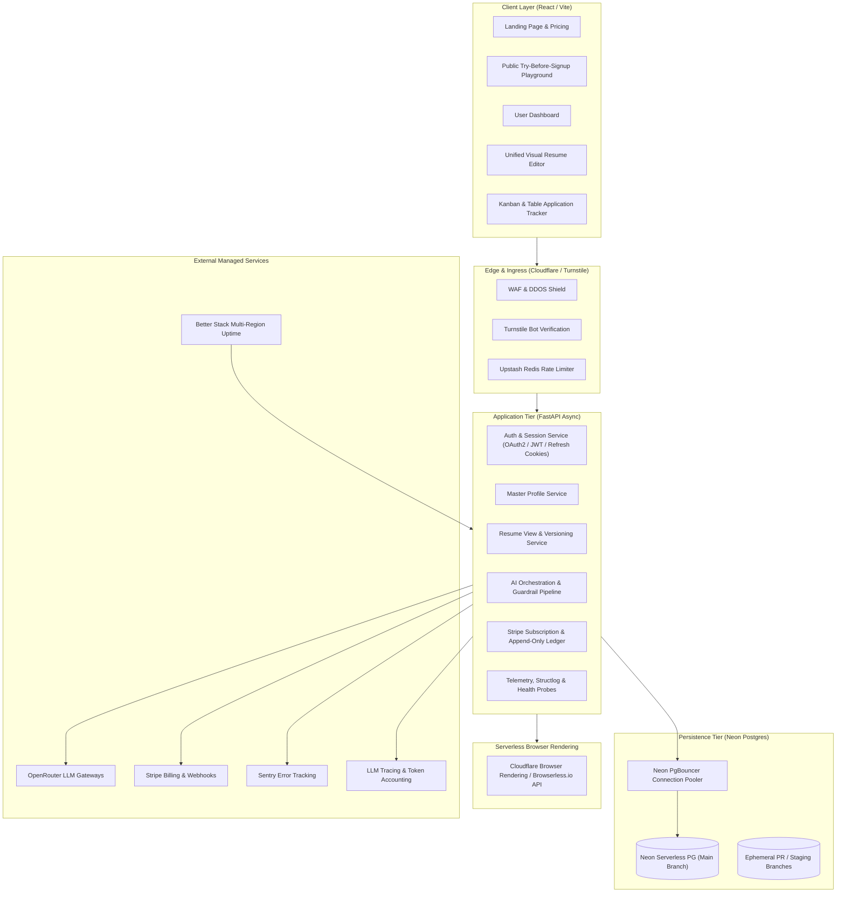
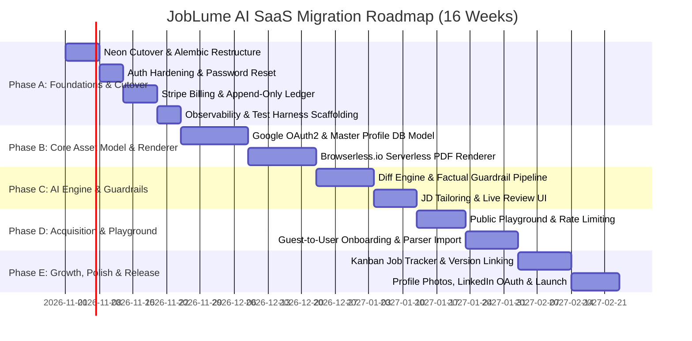

# JobLume AI: Production SaaS Adaptation Plan (v1.1)

**Document Reference:** `PRD_Adaptation_Plan_v1.md` (v1.1 — Approved with Modifications)
**Author:** Senior Staff Engineer & Technical Product Lead
**Target Codebase:** `HippomasAKiB1/Joblume-AI`
**PRD Reference:** `/docs/Job_Lume_AI_Product_Requirements_Document.md` (v1.0, Oct 19, 2026)
**Date:** October 20, 2026
**Status:** Approved by Leadership — Execution Authorization Granted

---

## Revision Log: v1.0 $\rightarrow$ v1.1 (Leadership Review Modifications)

The following modifications were reviewed, approved, and integrated into this adaptation plan following the initial architecture review:

- **Revision 1 (Q1: Master Profile Isolation):** Adopted Option A. Edits made in a specific resume remain isolated by default with an optional, non-blocking prompt: *"Update Master Profile as well?"*. Master Profile is protected from silent overwrites.
- **Revision 2 (Q2: Freemium Export Model):** Adopted modified Option B. Removed hard export count caps on the Free tier. Free tier now includes **unlimited PDF downloads of standard templates with a discreet footer watermark** (*"Made with JobLume"*). Pro tier removes the watermark, unlocks DOCX exports, and provides premium templates.
- **Revision 3 (Q3: Regional Profile Photos):** Approved. Stored inside `personal_info.photo_url` JSONB in Master Profile schema during Phase B. UI and ATS advisory warning ship in Phase E. Available to both Free and Pro users.
- **Revision 4 (Q4: Serverless Browser PDF Rendering):** Adopted Option B for initial phases. Replaced self-hosted Chromium worker with **Cloudflare Browser Rendering / Browserless.io** for Phases A–D to eliminate memory leak and operational risks for 1–2 engineers. Revisit self-hosted Playwright at $\ge 10\text{k}$ MAU. Cost model in §9 updated accordingly (+~$0.03–0.05 per PDF export).
- **Revision 5 (Q5: Auth Architecture):** Adopted Option A. Maintained self-hosted PyJWT + bcrypt. Hardened with HTTP-only SameSite refresh token cookies, 15-minute short-lived access tokens, and refresh token rotation. Google OAuth2 was originally planned for Phase A but deferred to Phase B Week 1 to protect the timeline (Correction 3). LinkedIn OAuth deferred to Phase E.
- **Revision 6 (Q6: Legacy Beta Users):** Approved. All current users with `subscription_tier = 'pro'` are grandfathered into 12 months of complimentary Pro with a *"Founding Member"* badge.
- **Revision 7 (M1: Immediate Security Action):** Leaked OpenRouter key in `backend/.render.yaml` sanitized (`sync: false`), rotated on OpenRouter, scrubbed from git history, and pre-commit scanning established.
- **Revision 8 (M2: Comprehensive Testing Pyramid):** Added explicit testing architecture: backend unit/integration tests against ephemeral Neon branches, Vitest for frontend utilities, Playwright for critical user journeys, LLM golden-set regression suite, and migration replay parity checks.
- **Revision 9 (M3: Observability Scaffolding):** Added backend health check probes (`/health/live`, `/health/ready`), Better Stack 60-second external multi-region uptime monitoring, Slack alerting thresholds (error rate > 1%, p95 latency > 500ms, DB connection exhaustion), and AI credit anomaly detection.
- **Revision 10 (M4: User-Facing Migration UX):** Defined seamless transition for existing users: Master Profile is auto-generated silently on cutover; users see their resumes immediately in the editor with a non-blocking banner introducing the Master Profile. No forced onboarding confirmation dialogs.
- **Revision 11 (M5: Append-Only Credit Ledger & Webhook Race Protection):** Structured credit accounting into an immutable, append-only `credit_transactions` ledger. Subscription status is derived directly from Stripe event streams with a daily automated reconciliation cron.
- **Revision 12 (M6: Authenticated AI Abuse Protection & Circuit Breakers):** Added per-user monthly credit hard stops (Free: 20/mo, Pro: 250/mo), per-user request rate limits (30 req/min Pro, 10 req/min Free), and a platform-wide daily circuit breaker ($2\times$ daily budget triggers degraded queuing and emergency alerts).

---

## 1. Executive Summary

JobLume AI is evolving from a functional portfolio prototype (React 18 SPA, FastAPI async backend, SQLAlchemy ORM, and Supabase-hosted PostgreSQL) into a multi-tenant B2C SaaS platform. The product promise is compelling: allow job seekers to maintain a single comprehensive **Master Profile**, generate tailored, ATS-optimized, high-fidelity resumes for target roles in seconds, and track their applications through offer acceptance.

### The Problem with the Current Prototype
While the current application demonstrates working end-to-end functionality—including resume authoring, cover letter generation, ATS scoring, and job application tracking—its architecture cannot scale to a commercial SaaS product:
1. **Flat Document Model:** Resumes are treated as monolithic rows with full JSON documents (`json_data`). There is no concept of a "Master Profile" separate from customized "Resume Views", forcing users to repeatedly re-enter work history or overwrite base records during AI tailoring.
2. **Rendering Engine Divergence:** The frontend renders resumes in HTML/CSS via client components, while the backend generates downloadable PDFs using Python's `reportlab` with hardcoded styling and colors. The exported PDF looks completely different from the live editor preview.
3. **Prototype Access & AI Mechanics:** Subscriptions are unlocked via a hardcoded pass-phrase check (`SECRET_CODE = "AKIB_LEVELUP"`); AI operations lack token accounting, rate limits, truthfulness validation, and diff-review controls; and an active OpenRouter API key was committed in plaintext to repository configuration.
4. **Database & Infrastructure Rigidity:** The database currently runs on Supabase as a raw Postgres instance without migration rigor (relying on `Base.metadata.create_all` and manual schema patching), lacking branch-per-preview workflows and autoscaling.

### The Transformation Strategy
This adaptation plan outlines the migration path to full PRD compliance without discarding existing working code:
- **Database Infrastructure:** Migrate the persistence tier to **Neon Postgres**, unlocking serverless autoscaling, copy-on-write branching per PR/preview environment, and pure database connection pooling via PgBouncer.
- **Architectural Shift:** Introduce a three-tier data hierarchy: **Master Profile** (canonical source of truth) $\rightarrow$ **Resume** (customized view/selection) $\rightarrow$ **Resume Version** (immutable snapshot linked to Job Applications). Existing user resumes will be nondestructively migrated into this new model with an unobtrusive user experience.
- **Rendering Unification:** Replace the dual-pipeline divergence with a unified HTML/CSS print-fidelity rendering pipeline driven by **managed serverless browser rendering (Cloudflare Browser Rendering / Browserless.io)**, ensuring pixel-identical live previews and PDF exports without running operational Chromium instances.
- **SaaS Hardening:** Replace prototype unlock phrases with **Stripe Billing** (Freemium with watermark vs. Pro with credit-metered AI and append-only ledger), implement **Upstash Redis** rate limiting and **Cloudflare Turnstile** bot protection for the public Playground, establish a verifiable AI truthfulness-check and diff-review workflow, and institute Sentry/Langfuse observability.

### Headline Effort & Timeline
Assuming **1 to 2 full-time senior engineers**, this migration encompasses **16 calendar weeks** across 5 distinct phases. Working features that exceed PRD MVP priorities (specifically Cover Letter Generation and deterministic ATS Scoring) will be retained and integrated into the Pro tier rather than deprecated.

---

## 2. Current State Audit

A thorough static and behavioral audit of the repository reveals the following baseline:

### 2.1 Backend Architecture & Routing
- **Entry Point & Framework:** FastAPI app defined in [`backend/app/main.py`](file:///e:/AKiB's Project Book/Joblume-AI/backend/app/main.py). Uses an async lifespan context manager calling `init_db()`.
- **CORS Configuration:** Allows `FRONTEND_URL`, `http://localhost:5173`, and `http://localhost:3000` via FastAPI's `CORSMiddleware`.
- **Active Routers:**
  - [`app/routers/auth.py`](file:///e:/AKiB's Project Book/Joblume-AI/backend/app/routers/auth.py): Implements `POST /auth/register` and `POST /auth/login`. Returns a PyJWT Bearer token and user payload. Password hashing utilizes raw `bcrypt` directly via [`app/auth/jwt_handler.py`](file:///e:/AKiB's Project Book/Joblume-AI/backend/app/auth/jwt_handler.py).
  - [`app/routers/users.py`](file:///e:/AKiB's Project Book/Joblume-AI/backend/app/routers/users.py): Implements `GET /user/profile`, `PUT /user/profile`, and `POST /user/upgrade`. Subscription upgrades are gated by checking `req.code.strip().upper() == "AKIB_LEVELUP"`.
  - [`app/routers/resumes.py`](file:///e:/AKiB's Project Book/Joblume-AI/backend/app/routers/resumes.py): Provides CRUD operations (`create`, `list`, `get`, `update`, `delete`) and binary exports (`export/pdf`, `export/docx`).
  - [`app/routers/ai.py`](file:///e:/AKiB's Project Book/Joblume-AI/backend/app/routers/ai.py): Endpoints for `/ai/tailor-job`, `/ai/generate-cover-letter`, `/ai/ats-score`, `/ai/upload-jd`, and `/ai/refine-resume`.
  - [`app/routers/applications.py`](file:///e:/AKiB's Project Book/Joblume-AI/backend/app/routers/applications.py): CRUD endpoints for job tracking (`create`, `list`, `update`, `delete`).
  - [`app/routers/admin.py`](file:///e:/AKiB's Project Book/Joblume-AI/backend/app/routers/admin.py): Admin endpoints `GET /admin/stats` and `GET /admin/users` gated by `require_admin`.

### 2.2 Database Tier & Alembic Status
- **Database Engine & Session:** [`backend/app/db/database.py`](file:///e:/AKiB's Project Book/Joblume-AI/backend/app/db/database.py) configures `create_async_engine` and `async_sessionmaker`. The connection URL dynamically normalizes `postgres://` or `postgresql://` into `postgresql+asyncpg://` via [`app/core/config.py`](file:///e:/AKiB's Project Book/Joblume-AI/backend/app/core/config.py).
- **Supabase Dependency Audit:** Code search confirms **zero** dependencies on Supabase-specific features (no Supabase Auth, no Supabase Storage buckets, no Supabase Realtime, and no Postgres Row-Level Security policies). The application treats Supabase strictly as a remote PostgreSQL 15+ host.
- **Database Initialization Antipattern:** [`init_db()`](file:///e:/AKiB's Project Book/Joblume-AI/backend/app/db/database.py#L37-L68) executes `Base.metadata.create_all`, programmatically injects a synthetic `alembic_version` row (`'4afc59cd58d6'`), and executes raw `ALTER TABLE users ADD COLUMN IF NOT EXISTS subscription_tier...`.
- **Alembic Versioning:** Only one migration exists: [`alembic/versions/4afc59cd58d6_add_is_admin_column.py`](file:///e:/AKiB's Project Book/Joblume-AI/backend/alembic/versions/4afc59cd58d6_add_is_admin_column.py). There is no initial migration script defining `users`, `resumes`, `applications`, `cover_letters`, or `ats_reports`.

### 2.3 Data Models
- **`User`** ([`app/models/user.py`](file:///e:/AKiB's Project Book/Joblume-AI/backend/app/models/user.py)): `id` (UUIDv4 str), `full_name`, `email` (unique index), `password_hash`, `subscription_tier` (default: "free"), `is_admin` (bool), `created_at`.
- **`Resume`** ([`app/models/resume.py`](file:///e:/AKiB's Project Book/Joblume-AI/backend/app/models/resume.py)): `id`, `user_id` (FK), `title`, `template_name`, `json_data` (JSON dict), `created_at`, `updated_at`.
- **`Application`** ([`app/models/application.py`](file:///e:/AKiB's Project Book/Joblume-AI/backend/app/models/application.py)): `id`, `user_id` (FK), `company`, `position`, `status`, `applied_date`, `notes`, `created_at`.
- **`CoverLetter`** ([`app/models/cover_letter.py`](file:///e:/AKiB's Project Book/Joblume-AI/backend/app/models/cover_letter.py)): `id`, `user_id` (FK), `job_title`, `company_name`, `content`, `created_at`.
- **`ATSReport`** ([`app/models/ats_report.py`](file:///e:/AKiB's Project Book/Joblume-AI/backend/app/models/ats_report.py)): `id`, `user_id` (FK), `resume_id` (FK), `score` (int), `suggestions` (JSON dict), `created_at`.

### 2.4 Rendering & PDF Generation
- **Frontend Live Preview:** [`frontend/src/pages/dashboard/ResumeBuilderPage.tsx`](file:///e:/AKiB's Project Book/Joblume-AI/frontend/src/pages/dashboard/ResumeBuilderPage.tsx) renders resume data into a `.preview-paper` DOM container using static CSS classes. It does **not** dynamically change layouts when switching `template_name`, nor does it support inline editing (edits occur via sidebar form tabs).
- **Backend PDF Pipeline:** [`backend/app/services/pdf_generator.py`](file:///e:/AKiB's Project Book/Joblume-AI/backend/app/services/pdf_generator.py) uses Python's `reportlab`. It builds a `SimpleDocTemplate` with hardcoded color `#4F46E5`, standard flowable paragraphs, and fixed Helvetica typography.
- **Drift Assessment:** **100% architectural divergence.** The live preview and the exported PDF use entirely distinct layout, styling, and rendering systems. The PDF export completely disregards user-chosen template options and CSS styles.

### 2.5 AI Service Layer & Guardrails
- **Provider & Connectivity:** Calls OpenRouter API (`https://openrouter.ai/api/v1/chat/completions`) using `aiohttp` in [`app/services/ai_service.py`](file:///e:/AKiB's Project Book/Joblume-AI/backend/app/services/ai_service.py).
- **Token Accounting & Quotas:** None. Requests are untracked; tokens and model compute costs are unmonitored.
- **PII Exposure:** Full personal data (candidate full name, phone number, physical location, email) is formatted as raw plaintext into prompt strings.
- **Hallucination Prevention:** Relies solely on soft system-prompt instructions (e.g., *"do not add fake information"*). There is no validation layer checking AI outputs against factual records.
- **Diff & Review Workflow:** Missing. `/ai/refine-resume` replaces the entire resume payload upon generation. In `/ai/tailor-job`, results are presented as read-only cards without an interactive diff or one-click apply button.

### 2.6 Shipped Features Beyond PRD MVP
- **Deterministic ATS Scorer:** [`backend/app/services/ats_scorer.py`](file:///e:/AKiB's Project Book/Joblume-AI/backend/app/services/ats_scorer.py) implements a rule-based scoring engine analyzing action verbs, section completeness, keyword density, and formatting reliability with zero LLM API cost. This feature is fully functional today.
- **Cover Letter Generation:** A dedicated Cover Letter engine and UI ([`frontend/src/pages/dashboard/CoverLetterPage.tsx`](file:///e:/AKiB's Project Book/Joblume-AI/frontend/src/pages/dashboard/CoverLetterPage.tsx)) are already implemented and operational.

---

## 3. Target State



---

## 4. Gap Analysis

| PRD Ref | Feature / Requirement | Current Codebase Status | Architectural Gap | Proposed Action | Effort | Technical Risk |
| :--- | :--- | :--- | :--- | :--- | :--- | :--- |
| **§4.1** | Auth, OAuth, GDPR Deletion | Email/Password JWT only; no social logins; no email verification. | Lacks Google OAuth, refresh token cookies, password reset, account deletion, and GDPR export endpoints. | **Extend** auth router with Google OAuth2, HTTP-only refresh cookies, and GDPR export/erasure endpoints. | Med (1.5 wks) | Low |
| **§4.2** | Master Profile (Single Source of Truth) | Non-existent. Resumes store full profile data redundantly in `resumes.json_data`. | No dedicated Master Profile table, schema, or UI manager. Edits in one resume do not benefit others. | **Build New** `master_profiles` table, backend service, and silent auto-generation migration for existing users. | High (2.5 wks) | Med |
| **§4.3** | Templates (Data-driven, ATS-safe) | 7 template identifiers defined in frontend array; no layout differences. | Templates do not change visual layouts in preview or PDF; purely cosmetic labels. | **Refactor** into a data-driven template engine with distinct HTML/CSS layouts sharing unified tokens. | High (2.5 wks) | Med |
| **§4.4** | Resume Editor with Inline Editing | Form-tab editor on left, static preview on right. No inline editing. | No inline contentEditable bindings; changes require navigating form inputs. | **Refactor** preview component into an interactive inline-editable canvas with autosave. | High (2.5 wks) | High |
| **§4.5** | Theme Customization & Contrast Guard | Static color variables; no dynamic theme token; no contrast checks. | Cannot set custom primary color per resume; no WCAG contrast guard. | **Extend** editor with `--resume-primary` token override and an algorithmic WCAG AA contrast validator. | Low (0.5 wks) | Low |
| **§4.6** | Section Management (Drag-and-Drop) | Fixed section order in tabs and preview; no custom sections. | Cannot reorder, rename, or add custom sections dynamically. | **Extend** with drag-and-drop ordering (`@hello-pangea/dnd`), visibility toggles, and custom section schemas. | Med (1.5 wks) | Low |
| **§4.7** | AI Optimization with Diff & Guardrails | AI updates overwrite entire JSON directly; no diffs; unmasked PII. | Lacks line-by-line diff review, factual verification against Master Profile, and PII masking. | **Refactor** AI service into a structured diff engine with deterministic factual guardrails and review UI. | High (2.5 wks) | High |
| **§4.8** | JD-Based Tailoring | Suggestions returned as static cards; requires manual copy-pasting. | Does not generate a tailored Resume Version or attach to a Job Application. | **Refactor** to create an automated tailored `ResumeVersion` derived from Master Profile + JD keywords. | Med (2 wks) | Med |
| **§4.9** | ATS Check & Scoring | Shipped deterministic rule-based engine in `ats_scorer.py` (better than PRD P1). | Scoring runs independently; not integrated into live editor or version history. | **Keep & Extend** existing rule-based engine; embed score widget directly into editor toolbar. | Low (0.5 wks) | Low |
| **§4.10**| Version Control & Snapshots | Non-existent. Updates overwrite the resume record in place. | No `resume_versions` table, historical diffs, restore points, or company/role tagging. | **Build New** `resume_versions` table and version timeline drawer with restore/compare capabilities. | Med (1.5 wks) | Low |
| **§4.11**| Job Tracking Portal | Table-only CRUD in `applications.py`; no resume version linking. | Lacks Kanban view, drag-and-drop status pipelines, JD text storage, and version associations. | **Extend** with Kanban board UI, extended metadata fields, and foreign key link to `resume_versions`. | Med (1.5 wks) | Low |
| **§4.12**| High-Fidelity Export (PDF/DOCX) | Dual pipeline divergence (ReportLab PDF vs HTML DOM). | Downloaded PDF does not visually match the browser preview. | **Refactor** to Serverless Chromium (Browserless.io / Cloudflare) shared between preview and server export. | High (2 wks) | Med |
| **§4.13**| Public Playground | Non-existent. Site requires registration immediately. | No anonymous visitor flow, device fingerprinting, or guest-to-account onboarding conversion. | **Build New** `/playground` route with client-side state, Upstash rate limiting, and onboarding data import. | Med (2 wks) | Med |
| **N/A**  | Cover Letter Generation | Shipped in `cover_letter.py` and `CoverLetterPage.tsx` (PRD non-goal v1). | Currently detached from the Job Application tracking workflow. | **Keep** feature intact; link generated cover letters to `job_applications` as a Pro-tier asset. | Low (0.5 wks) | Low |
| **N/A**  | Billing & Subscription Infrastructure | Hardcoded phrase `"AKIB_LEVELUP"` in `users.py`. | No payment processing, webhook listener, invoice handling, or credit balance ledger. | **Build New** Stripe Checkout/Portal integration with append-only ledger and reconciliation cron. | Med (2 wks) | Med |
| **N/A**  | Database Infrastructure & Migrations | Supabase Postgres with single Alembic script and `create_all` boot hook. | No branching workflow, no baseline migration, connection pooling issues with async workers. | **Migrate** to Neon Postgres; establish clean Alembic migrations and CI branch provisioning. | Med (1.5 wks) | Med |

---

## 5. Architectural Decisions

### Decision A: Master Profile / Resume / Version Separation
- **Recommendation:** **Adopt immediately in Phase A & B.**
- **Rationale:** The current model binds career data directly to a single document instance. Edits made in a resume remain isolated by default with an optional prompt: *"Update Master Profile as well?"* (Q1 Resolution).
- **Migration Path:** Existing user resumes are migrated nondestructively into a newly created `master_profiles` row silently upon login without interrupting user velocity (M4 Resolution).

### Decision B: Unified Serverless Renderer (Eliminating PDF Drift)
- **Recommendation:** **Adopt Cloudflare Browser Rendering / Browserless.io initially (Option B), migrating to self-hosted Chromium only at $\ge 10\text{k}$ MAU (Q4 Resolution).**
- **Rationale:** 1–2 engineers cannot afford the operational burden of managing headless Chromium memory leaks, zombie processes, and Linux font packages in a shared container. Serverless browser rendering provides high-reliability, zero-devops PDF generation for ~$0.03–0.05 per render.
- **Parity Guarantee:** The serverless worker receives the exact same HTML payload, CSS tokens (`--resume-primary`), and Google Fonts used in the live editor preview, ensuring 100% pixel-perfect PDF export.

### Decision C: AI Guardrails & Truthfulness Architecture
- **Recommendation:** Implement a **two-stage verification pipeline** combined with **interactive diff reviews**.
- **Stage 1 (Constrained Generation):** The LLM receives the Master Profile and target JD with PII removed (candidate full name, phone, email, and address replaced with anonymized tokens `{{CANDIDATE_NAME}}`, `{{EMAIL}}`, etc.).
- **Stage 2 (Deterministic Truthfulness Engine):** A non-LLM validation gate compares `proposed_text` against the Master Profile, guaranteeing no ungrounded companies, titles, degrees, or dates.
- **Stage 3 (Client Diff Review):** The user receives a visual side-by-side diff with line-by-line **Accept / Edit / Reject** toggles before committing changes.

### Decision D: Playground Quota & Abuse Prevention
- **Recommendation:** Multi-layered defense using Cloudflare Turnstile, Upstash Redis sliding-window rate limiting (3 AI attempts / 24h per IP & device hash), and client-side draft buffers.
- **Conversion Gate:** Playground PDF export generates a watermarked preview; full watermark-free export requires free account creation.

### Decision E: Billing, Credit Ledger & Abuse Prevention
- **Recommendation:** **Stripe Checkout & Billing Portal** with an **append-only credit ledger** (M5 Resolution) and **multi-layered rate limits** (M6 Resolution).
- **Product Tiers (Q2 Resolution):**
  - **Free Tier ($0/mo):** 1 Master Profile, 2 active Resumes, 5 tracked Job Applications, 3 standard ATS templates, **unlimited PDF exports with a discreet footer watermark** (*"Made with JobLume"*), and **20 AI credits/month** (refreshed every 30 days; hard stop at 20).
  - **Pro Tier ($12/mo or $96/yr):** 1 Master Profile, unlimited Resumes, unlimited Resume Versions, unlimited Job Applications, all 8+ templates, **watermark removed**, DOCX export, cover letter generator, unlimited deterministic ATS checks, and **250 AI credits/month** (soft warning at 200, hard stop at 250).
- **Append-Only Credit Architecture (M5):**
  - Table `credit_transactions` records every credit delta (`+250` monthly grant, `-10` JD tailoring, `-1` bullet refinement) with `balance_after`.
  - Current balance is calculated via atomic transactions; no race conditions.
  - Daily reconciliation cron verifies local subscription statuses against Stripe event stream.
- **Platform Circuit Breaker (M6):** If total platform daily AI spend exceeds $2\times$ projected daily budget, backend enters degraded mode (throttles non-Pro requests, posts high-priority alert to Slack).
- **Beta User Grandfathering (Q6):** Current `subscription_tier = 'pro'` users are granted 12 months complimentary Pro with a *"Founding Member"* badge.

### Decision F: Template System Architecture & Profile Photos
- **Recommendation:** Data-driven template registry sharing standardized CSS variables.
- **Profile Photo Support (Q3 Resolution):** Stored inside `personal_info.photo_url` JSONB in Master Profile schema in Phase B. UI and ATS advisory warning ship in Phase E. Available to both Free and Pro users.

### Decision G: Scope Reconciliation (Cover Letters & ATS Scoring)
- **Recommendation:** **Retain both features in the active product surface.** Do not demote or delete. Cover Letters remain a Pro feature; deterministic ATS Scoring remains a free freemium acquisition engine.

---

## 6. Data Model & Migration Plan

### 6a. Target Relational Schema (PostgreSQL DDL)

```sql
-- 1. Subscriptions Table
CREATE TABLE subscriptions (
    id UUID PRIMARY KEY DEFAULT gen_random_uuid(),
    user_id UUID NOT NULL REFERENCES users(id) ON DELETE CASCADE,
    plan_tier VARCHAR(50) NOT NULL DEFAULT 'free',
    status VARCHAR(50) NOT NULL DEFAULT 'active',
    stripe_customer_id VARCHAR(255),
    stripe_subscription_id VARCHAR(255),
    ai_credits_balance INTEGER NOT NULL DEFAULT 20,
    current_period_end TIMESTAMPTZ,
    created_at TIMESTAMPTZ NOT NULL DEFAULT NOW(),
    updated_at TIMESTAMPTZ NOT NULL DEFAULT NOW(),
    CONSTRAINT uq_subscriptions_user UNIQUE(user_id)
);

-- 2. Append-Only Credit Ledger (M5)
CREATE TABLE credit_transactions (
    id UUID PRIMARY KEY DEFAULT gen_random_uuid(),
    user_id UUID NOT NULL REFERENCES users(id) ON DELETE CASCADE,
    amount INTEGER NOT NULL, -- positive for grants, negative for spend
    balance_after INTEGER NOT NULL,
    transaction_type VARCHAR(50) NOT NULL, -- monthly_grant, ai_tailor, ai_refine, admin_adjustment
    reference_id VARCHAR(255), -- ai_job_id or stripe_invoice_id
    created_at TIMESTAMPTZ NOT NULL DEFAULT NOW()
);
CREATE INDEX idx_credit_transactions_user ON credit_transactions(user_id, created_at DESC);

-- 3. Master Profiles Table (Single Source of Truth, incl. photo_url Q3)
CREATE TABLE master_profiles (
    id UUID PRIMARY KEY DEFAULT gen_random_uuid(),
    user_id UUID NOT NULL REFERENCES users(id) ON DELETE CASCADE,
    personal_info JSONB NOT NULL DEFAULT '{"fullName":"","email":"","phone":"","location":"","website":"","linkedin":"","github":"","photo_url":null}'::jsonb,
    summary TEXT DEFAULT '',
    experience JSONB NOT NULL DEFAULT '[]'::jsonb,
    education JSONB NOT NULL DEFAULT '[]'::jsonb,
    projects JSONB NOT NULL DEFAULT '[]'::jsonb,
    skills JSONB NOT NULL DEFAULT '[]'::jsonb,
    certifications JSONB NOT NULL DEFAULT '[]'::jsonb,
    languages JSONB NOT NULL DEFAULT '[]'::jsonb,
    awards JSONB NOT NULL DEFAULT '[]'::jsonb,
    custom_sections JSONB NOT NULL DEFAULT '[]'::jsonb,
    created_at TIMESTAMPTZ NOT NULL DEFAULT NOW(),
    updated_at TIMESTAMPTZ NOT NULL DEFAULT NOW(),
    CONSTRAINT uq_master_profiles_user UNIQUE(user_id)
);

-- 4. Resumes Table (Views over Master Profile)
CREATE TABLE resumes_v2 (
    id UUID PRIMARY KEY DEFAULT gen_random_uuid(),
    user_id UUID NOT NULL REFERENCES users(id) ON DELETE CASCADE,
    master_profile_id UUID NOT NULL REFERENCES master_profiles(id) ON DELETE CASCADE,
    title VARCHAR(255) NOT NULL DEFAULT 'Untitled Resume',
    template_id VARCHAR(100) NOT NULL DEFAULT 'modern-professional',
    primary_color VARCHAR(30) NOT NULL DEFAULT '#4F46E5',
    font_family VARCHAR(50) NOT NULL DEFAULT 'Inter',
    section_order JSONB NOT NULL DEFAULT '["personal","summary","experience","education","skills","projects","certifications"]'::jsonb,
    section_visibility JSONB NOT NULL DEFAULT '{}'::jsonb,
    content_overrides JSONB NOT NULL DEFAULT '{}'::jsonb,
    company_tag VARCHAR(255),
    role_tag VARCHAR(255),
    created_at TIMESTAMPTZ NOT NULL DEFAULT NOW(),
    updated_at TIMESTAMPTZ NOT NULL DEFAULT NOW()
);

-- 5. Resume Versions Table (Immutable Snapshots)
CREATE TABLE resume_versions (
    id UUID PRIMARY KEY DEFAULT gen_random_uuid(),
    resume_id UUID NOT NULL REFERENCES resumes_v2(id) ON DELETE CASCADE,
    version_number INTEGER NOT NULL,
    label VARCHAR(255) NOT NULL,
    change_source VARCHAR(50) NOT NULL DEFAULT 'manual', -- manual, ai_prompt, jd_tailor
    snapshot_data JSONB NOT NULL,
    note TEXT,
    created_at TIMESTAMPTZ NOT NULL DEFAULT NOW(),
    CONSTRAINT uq_resume_version_order UNIQUE(resume_id, version_number)
);

-- 6. Enhanced Job Applications Table
ALTER TABLE applications ADD COLUMN IF NOT EXISTS resume_version_id UUID REFERENCES resume_versions(id) ON DELETE SET NULL;
ALTER TABLE applications ADD COLUMN IF NOT EXISTS job_url TEXT;
ALTER TABLE applications ADD COLUMN IF NOT EXISTS salary_range VARCHAR(100);
ALTER TABLE applications ADD COLUMN IF NOT EXISTS work_type VARCHAR(50) DEFAULT 'remote';
ALTER TABLE applications ADD COLUMN IF NOT EXISTS jd_text TEXT;
ALTER TABLE applications ADD COLUMN IF NOT EXISTS contact_name VARCHAR(255);
ALTER TABLE applications ADD COLUMN IF NOT EXISTS contact_email VARCHAR(255);
ALTER TABLE applications ADD COLUMN IF NOT EXISTS deadline DATE;
ALTER TABLE applications ADD COLUMN IF NOT EXISTS updated_at TIMESTAMPTZ DEFAULT NOW();

-- 7. Application Events Table
CREATE TABLE application_events (
    id UUID PRIMARY KEY DEFAULT gen_random_uuid(),
    application_id UUID NOT NULL REFERENCES applications(id) ON DELETE CASCADE,
    event_type VARCHAR(50) NOT NULL,
    event_date TIMESTAMPTZ NOT NULL DEFAULT NOW(),
    notes TEXT,
    created_at TIMESTAMPTZ NOT NULL DEFAULT NOW()
);

-- 8. AI Operations & Telemetry Ledger
CREATE TABLE ai_jobs (
    id UUID PRIMARY KEY DEFAULT gen_random_uuid(),
    user_id UUID REFERENCES users(id) ON DELETE SET NULL,
    job_type VARCHAR(50) NOT NULL,
    model_name VARCHAR(100) NOT NULL,
    prompt_tokens INTEGER NOT NULL DEFAULT 0,
    completion_tokens INTEGER NOT NULL DEFAULT 0,
    cost_usd NUMERIC(8, 5) NOT NULL DEFAULT 0.00000,
    credits_deducted INTEGER NOT NULL DEFAULT 0,
    status VARCHAR(50) NOT NULL DEFAULT 'completed',
    created_at TIMESTAMPTZ NOT NULL DEFAULT NOW()
);
```

### 6b. User-Facing Migration Experience (M4)
To ensure zero churn or friction when existing users log in following the cutover:
1. **Silent Background Synthesis:** The migration script automatically parses each user's latest resume and creates their `master_profiles` row behind the scenes.
2. **Immediate Continuity:** When the user logs in, their resumes appear exactly as they left them in the editor.
3. **Unobtrusive Banner:** A subtle, dismissible alert is rendered at the top of the editor:
   > *"💡 We've organized your career data into a Master Profile. Updating your Master Profile makes generating future job-tailored resumes even faster."*
4. **No Forced Modals:** The user can continue editing and downloading their existing resume without being forced through an onboarding or profile verification wizard.

---

## 7. SaaS Readiness Plan

### 7.1 Multi-Tenancy & Data Isolation
- Enforce foreign keys with `ON DELETE CASCADE`.
- Implement a SQLAlchemy query interceptor that automatically enforces `where(Model.user_id == current_user.id)` on all multi-tenant models.
- Add CI integration tests that explicitly verify cross-tenant data isolation.

### 7.2 Authentication & User Security (Q5)
- Retain self-hosted PyJWT + bcrypt.
- Implement short-lived access tokens (15-minute expiration) and HTTP-only Secure SameSite cookies for refresh tokens.
- Add refresh token rotation to prevent replay attacks.
- Implement password reset via signed tokens and Resend API.
- Google OAuth2 social login deferred to Phase B Week 1 (Correction 3); LinkedIn OAuth deferred to Phase E.

### 7.3 Testing Architecture & Verification (M2)
- **Backend Unit Tests:** Test isolated services (ATS scoring rules, PII masking, token calculators, factual validation filters) with `pytest`.
- **Backend Integration Tests:** Execute API endpoints against a real ephemeral Neon branch to test database queries, foreign keys, and rollbacks.
- **Frontend Tests:** Vitest for utility functions and token calculations; Playwright for critical user journeys (Registration $\rightarrow$ Builder $\rightarrow$ PDF Download).
- **LLM Golden-Set Regressions:** 20 benchmark resumes with known edge cases evaluated automatically against model changes to verify 0% hallucination rate and strict schema conformity.
- **Migration Replay Verification:** Replay Supabase dump against a staging Neon branch and verify row-count and column-value parity before production cutover.

### 7.4 Observability & Uptime Scaffolding (M3)
- **Health Check Probes:**
  - `GET /health/live`: Fast liveness check verifying the HTTP worker process is responsive.
  - `GET /health/ready`: Readiness check verifying active database pooler connectivity and cache response.
- **External Uptime Monitoring:** Configure Better Stack (or UptimeRobot) pinging `/health/ready` every 60 seconds from North America and Europe.
- **Slack Alerting Thresholds:**
  - Error rate $> 1\%$ over a 5-minute window.
  - API p95 latency $> 500\text{ms}$.
  - Database pooler connection utilization $> 85\%$.
  - Daily AI spend anomaly ($> 2\times$ rolling average).

### 7.5 Rate Limiting, Abuse Prevention & Circuit Breakers (M6)
- **Playground:** 3 free AI attempts / 24 hours per IP & device fingerprint via Upstash Redis + Cloudflare Turnstile.
- **Authenticated Per-User Rates:** 30 req/min for Pro users, 10 req/min for Free users.
- **Monthly AI Credit Hard Stops:** Free tier capped at 20 credits/mo. Pro tier provides soft warning at 200 credits, hard stop at 250 credits.
- **Platform Circuit Breaker:** If aggregate platform AI cost exceeds $2\times$ daily budget, system gracefully degrades non-Pro requests into an asynchronous background queue and triggers an emergency Slack alert.

---

## 8. Phased Roadmap



### Phase A: Infrastructure Cutover, Database, Auth & Billing (Weeks 1–3)
- **Scope:**
  - Incident response (M1): sanitize `.render.yaml`, rotate OpenRouter key, install pre-commit secret scanner.
  - Cutover from Supabase to Neon Postgres with PgBouncer transaction pooling.
  - Alembic refactor: delete `create_all` boot hook; create baseline 0001 and SaaS 0002.
  - Auth hardening: 15-min access tokens, HTTP-only refresh cookies, refresh rotation, and password reset via Resend (Google OAuth moved to Phase B).
  - Stripe integration: Checkout, Billing Portal, append-only `credit_transactions` ledger, daily reconciliation cron.
  - Observability & Testing: health probes, Better Stack uptime, Slack alerts, pytest suite on Neon branches.
- **Exit Criteria:** Zero-downtime Neon cutover verified; Stripe checkout working end-to-end; CI testing passes.

### Phase B: Master Profile, Google OAuth, Data Hierarchy & Serverless Renderer (Weeks 4–7)
- **Scope:**
  - Task D.3: Google OAuth2 integration (moved from Phase A).
  - Build `master_profiles`, `resumes_v2`, and `resume_versions` tables and APIs.
  - Execute silent data migration for existing resumes; display non-blocking Master Profile banner (M4).
  - Integrate **Cloudflare Browser Rendering / Browserless.io** API for serverless PDF generation (Q4).
  - Implement data-driven templates (Modern, Minimal ATS, Executive, Academic) with `--resume-primary` and contrast guard.
  - Add Free tier watermark (*"Made with JobLume"*) to standard PDF templates (Q2).
- **Exit Criteria:** Exported PDF matches live preview pixel-for-pixel; existing user resumes fully operational.

### Phase C: AI Optimization Engine, Diff Reviews & Guardrails (Weeks 8–10)
- **Scope:** Structured JSON patch pipeline, deterministic factual guardrail verification, client diff-review modal, PII masking, token accounting via Langfuse.

### Phase D: Acquisition, Public Playground & Onboarding (Weeks 11–13)
- **Scope:** Public `/playground` route, Upstash rate limiting, Cloudflare Turnstile, `localStorage` draft buffer, PDF/DOCX resume file parser with user confirmation screen.

### Phase E: Growth Features, Profile Photos & Production Launch (Weeks 14–16)
- **Scope:** Kanban job tracker, profile photo uploader with ATS warning (Q3), LinkedIn OAuth, GDPR data export/deletion, 99.9% uptime verification.

---

## 9. Revised Cost Model (Reflecting Serverless Browser Rendering)

### Revised Monthly Expenditure Projections

| Infrastructure Component | 100 Active Users (Launch) | 1,000 Active Users (Traction) | 10,000 Active Users (Scale) |
| :--- | :--- | :--- | :--- |
| **Neon Postgres** | $0.00 (Generous Free Tier) | $19.00 (Launch Plan, compute autoscaling) | $95.00 (Scale Plan + storage add-ons) |
| **Backend Compute (Render/Fly.io)** | $7.00 (1 Shared Instance) | $25.00 (2 Balanced Compute Instances) | $140.00 (Autoscaled Container Cluster) |
| **Serverless PDF Rendering (Browserless.io / Cloudflare)** | **$5.00** (~150 renders @ $0.035) | **$52.50** (~1,500 renders @ $0.035) | **$525.00** (~15,000 renders @ $0.035) |
| **Frontend Hosting (Vercel / Cloudflare)**| $0.00 (Cloudflare Pages) | $20.00 (Vercel Pro) | $40.00 (Vercel Pro + Bandwidth) |
| **Upstash Redis (Rate Limiting)** | $0.00 (Free Tier) | $5.00 (Pay-as-you-go) | $30.00 (Enterprise Capped) |
| **Cloudflare (Turnstile + DNS + CDN)** | $0.00 (Standard Free Tier) | $0.00 (Free Tier) | $20.00 (Cloudflare Pro) |
| **Sentry & Observability (Langfuse)** | $0.00 (Developer Free Tier) | $29.00 (Sentry Team + Hosted Langfuse) | $120.00 (Volume Tier Observability) |
| **Transactional Email (Resend/SendGrid)**| $0.00 (Free Tier) | $15.00 (Basic Plan) | $45.00 (Volume Growth Tier) |
| **Stripe Billing Overhead** | ~$15.00 (2.9% + 30¢ on ~5 Pro subs)| ~$150.00 (on ~50 Pro subs) | ~$1,500.00 (on ~500 Pro subs) |
| **Variable LLM Compute (OpenRouter)** | **$12.50** | **$120.00** | **$1,180.00** |
| **Total Estimated Monthly Spend** | **~$39.50 / month** | **~$435.50 / month** | **~$3,695.00 / month** |

### Revised Unit Economics per Pro User ($12.00/mo Revenue)
- LLM Token Consumption: ~$1.20
- Serverless PDF Rendering (Browserless.io, ~10 exports/mo): **~$0.35** (revised from $0.15)
- Database & storage share: ~$0.10
- Stripe transaction fee: ~$0.65
- **Total Variable COGS per Pro User:** **~$2.30 / month**
- **Contribution Margin per Pro User:** **$9.70 (80.8% Gross Margin)**. Demonstrates strong unit economics with zero server browser management overhead.

---

## 10. Risk Register

| # | Risk Description | Likelihood | Impact | Severity | Mitigation Strategy | Owner |
| :-: | :--- | :-: | :-: | :-: | :--- | :--- |
| **1** | **AI Factual Hallucination:** LLM fabricates false employers, degrees, or metrics in tailored resumes. | High | High | **CRITICAL** | Implement deterministic factual guardrail filter comparing output against Master Profile; mandate interactive diff review. | AI Lead |
| **2** | **Serverless Rendering Outage / Throttling:** Third-party browser rendering API suffers downtime. | Low | High | **HIGH** | Maintain fallback to secondary serverless provider (Cloudflare $\leftrightarrow$ Browserless.io) via common REST adapter. | Infra Lead |
| **3** | **Playground Token Scraping Attack:** Malicious actors bypass frontend to drain OpenRouter credits via the playground. | High | High | **HIGH** | Server-side Cloudflare Turnstile token validation; Upstash Redis IP & fingerprint sliding-window rate limiting. | Security Lead |
| **4** | **Data Loss During Cutover:** Database migration from Supabase to Neon drops records or sequences. | Low | High | **HIGH** | Verify row-count parity scripts; conduct dry-run cutover on staging branch; maintain Supabase read-only backup for 14 days. | Data Lead |
| **5** | **User Friction on Master Profile Onboarding:** Users drop off when asked to fill a comprehensive Master Profile up-front. | High | Med | **HIGH** | Auto-generate Master Profile silently from existing resume; provide non-blocking banner rather than forced onboarding. | Product Lead |
| **6** | **OpenRouter Outage or Rate Limit:** Third-party gateway experiences downtime or throttles requests. | Med | Med | **MED** | Configure fallback direct provider API keys (OpenAI / Anthropic SDKs) triggered automatically on OpenRouter HTTP 5xx errors. | Backend Lead |
| **7** | **ATS Formatting Parser Incompatibility:** Exported PDFs fail to parse properly in older enterprise ATS parsers. | Low | High | **MED** | Enforce single-column reading order in ATS templates; run automated tests using `pdfplumber` to verify selectable text streams. | Frontend Lead |
| **8** | **Stripe Webhook Delivery Drops:** Network failures cause missed subscription upgrade events. | Low | Med | **MED** | Implement append-only transaction ledger; run a daily reconciliation job polling Stripe API for un-synced customer statuses. | Backend Lead |
| **9** | **Neon Branching Schema Drift:** Developers fail to run migrations before merging PRs, desynchronizing branches. | Med | Low | **LOW** | Enforce CI release checks that automatically run migration dry-runs against an ephemeral copy of the production branch. | DevOps Lead |
| **10**| **Leaked Credentials Exploitation:** Previously committed OpenRouter API key exploited before revocation. | Med | High | **HIGH** | Key rotated on OpenRouter console; `.render.yaml` sanitized with `sync: false`; pre-commit hooks installed. | Security Lead |

---

## 11. Decisions on Initial Open Questions (Finalized)

All initial open questions have been formally resolved as follows:

1. **Master Profile Auto-Sync Default:** **Option A Adopted.** Edits made in a specific resume remain isolated by default with an optional prompt: *"Update Master Profile as well?"*.
2. **Free Tier Export Limitation:** **Modified Option B Adopted.** Unlimited PDF exports of standard templates with a discreet footer watermark (*"Made with JobLume"*). No hard export caps. Pro tier removes watermark and unlocks DOCX.
3. **Regional Profile Photos:** **Approved.** Stored in `personal_info.photo_url` JSONB in Phase B schema. Editor uploader and ATS warning advisory ship in Phase E. Available to all users.
4. **Headless Chromium Execution Environment:** **Option B Adopted.** Cloudflare Browser Rendering / Browserless.io used for initial phases; self-hosted Chromium evaluated at $\ge 10\text{k}$ MAU.
5. **Session & Auth Architecture:** **Option A Adopted.** Self-hosted PyJWT + bcrypt hardened with 15-min access tokens, HTTP-only SameSite refresh cookies, refresh rotation, and Google OAuth2.
6. **Existing Beta User Legacy Policy:** **Approved.** Current `subscription_tier = 'pro'` users grandfathered into 12 months complimentary Pro with a *"Founding Member"* badge.

---

## 12. Explicit "Do Not Touch" List (Phase A Stability Protection)

To preserve engineering velocity and protect working features during Phase A, engineers must **NOT** refactor, rewrite, or modify the following files or components during **Phase A**:

1. **[`backend/app/services/ats_scorer.py`](file:///e:/AKiB's Project Book/Joblume-AI/backend/app/services/ats_scorer.py):**
   - *Rationale:* Deterministic ATS scoring algorithm works with 100% reliability and zero LLM cost. Leave untouched until Phase E integration.
2. **[`backend/app/services/file_parser.py`](file:///e:/AKiB's Project Book/Joblume-AI/backend/app/services/file_parser.py):**
   - *Rationale:* PDF/DOCX extraction routines work reliably for job description uploads. Leave untouched until Phase D onboarding imports.
3. **[`backend/app/models/cover_letter.py`](file:///e:/AKiB's Project Book/Joblume-AI/backend/app/models/cover_letter.py) & [`frontend/src/pages/dashboard/CoverLetterPage.tsx`](file:///e:/AKiB's Project Book/Joblume-AI/frontend/src/pages/dashboard/CoverLetterPage.tsx):**
   - *Rationale:* Feature is operational and valuable. Leave schema and UI untouched until Phase E.
4. **[`frontend/src/index.css`](file:///e:/AKiB's Project Book/Joblume-AI/frontend/src/index.css) & Global Design Tokens:**
   - *Rationale:* The core atomic design system, CSS variables, dark/light mode engine, and typography tokens are well-crafted. Do not introduce TailwindCSS or rewrite global stylesheets.
5. **[`backend/app/routers/admin.py`](file:///e:/AKiB's Project Book/Joblume-AI/backend/app/routers/admin.py) & [`frontend/src/pages/admin/`](file:///e:/AKiB's Project Book/Joblume-AI/frontend/src/pages/admin/):**
   - *Rationale:* Admin metrics and user listing operate independently. Preserve as-is until after database migration has stabilized.

---

*End of Plan Document v1.1. Proceed to Phase A Execution Plan.*
