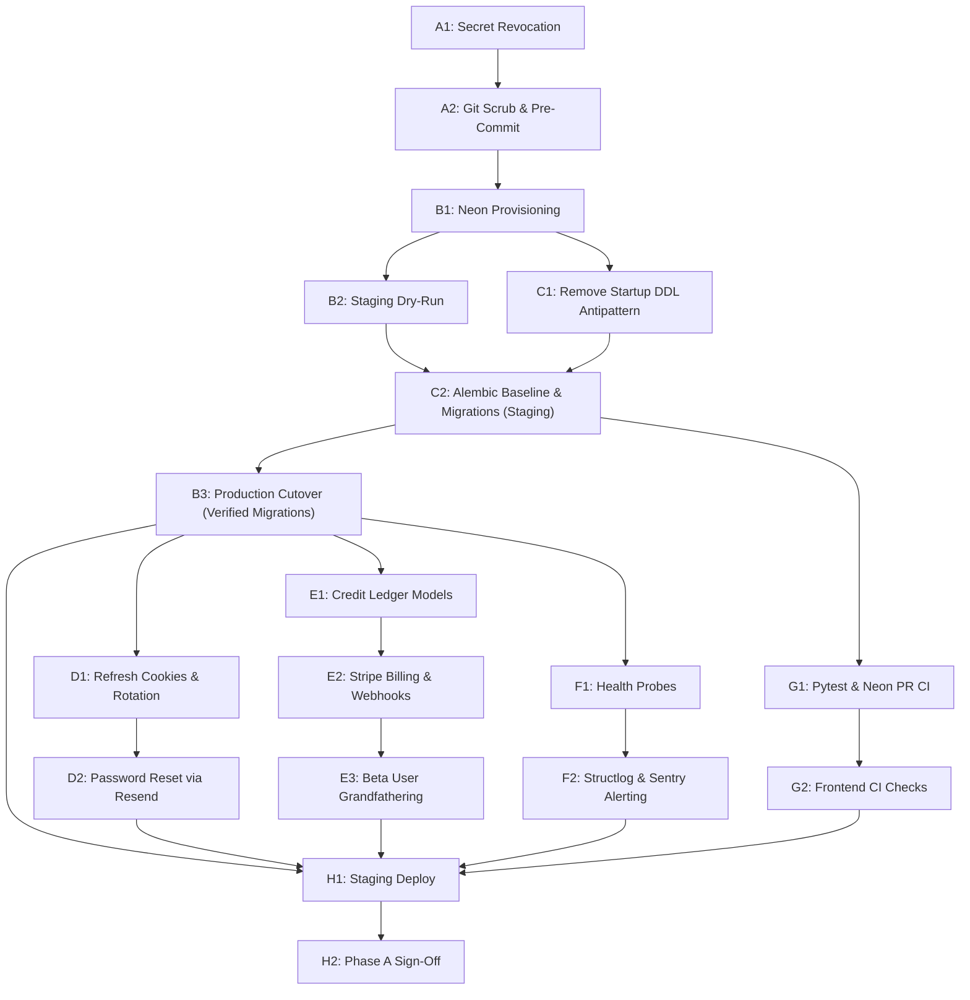

# JobLume AI: Phase A Execution Plan (v1.1)

**Document Reference:** `Phase_A_Execution_Plan.md` (v1.1 — Execution Authorized with Corrections)
**Parent Plan:** `/docs/PRD_Adaptation_Plan_v1.md` (v1.1)
**Author:** Senior Staff Engineer & Technical Product Lead
**Scope:** Phase A (Foundations, Infrastructure Cutover, Hardened Auth, Stripe Billing, Observability)
**Assumed Capacity:** 1–2 Full-Time Engineers, 3 Calendar Weeks (15 Working Days)
**Date:** October 20, 2026
**Status:** In Execution (M1 Executed — Awaiting Force-Push Approval)

---

## Revision Log: v1.0 $\rightarrow$ v1.1 (Leadership Review Corrections)

The following corrections have been incorporated into this Phase A execution plan:

- **Revision 1 (Sequencing Bug Fix — Correction 2):** Resolved the conflict between Task C.2 (Alembic migrations) and Task B.3 (Production cutover). In v1.0, cutover was scheduled on Day 4 before migrations were written on Day 5. The revised sequence ensures all migrations are developed, tested, and verified against Neon Staging *before* production cutover:
  - **Day 1:** Tasks A.1, A.2 (Security Incident Response & Git Scrubbing)
  - **Day 2:** Task B.1 (Neon Provisioning & Dual Connection Strings)
  - **Day 3:** Task B.2 (Staging Dry-Run) + Task C.1 (Remove `create_all` Antipattern)
  - **Day 4:** Task C.2 (Baseline 0001 & Phase A 0002 Migrations on Neon Staging)
  - **Day 5:** Task B.3 (Production Cutover with Verified Migrations & Parity Check)
- **Revision 2 (Scope Adjustment: Defer Google OAuth — Correction 3):** Task D.3 (Google OAuth2) has been removed from Phase A and moved to Phase B Week 1. This reclaims 1 full engineer-day of buffer for Phase A. Auth hardening in Phase A is strictly focused on: 15-minute access tokens, HTTP-only refresh cookies, refresh rotation, and password resets via Resend.
- **Revision 3 (Stripe KYC Readiness Gate — Correction 4):** Added an explicit verification gate to Task E.2. If business registration or KYC approval is pending, Task E.2 will be executed exclusively against **Stripe Test Mode** with test keys, with live-mode activation gated behind Phase E.
- **Revision 4 (M1 Immediate Status):** Noted execution of local history scrubbing and pre-commit hook installation; force-push to remote main gated behind explicit user confirmation.

---

## 1. Phase A Objective

Phase A establishes the secure, observable, production-grade foundation for JobLume AI. "Done" means:
1. The database persistence tier has completely cut over from Supabase to **Neon Postgres** with PgBouncer connection pooling and zero data loss.
2. The prototype database boot antipattern (`create_all`) is replaced by clean **Alembic forward migrations** integrated with dynamic Neon copy-on-write PR branching.
3. User accounts are protected by **hardened authentication** (short-lived 15-minute access tokens, HTTP-only SameSite refresh token rotation, and password reset via signed tokens).
4. Prototype unlock passcodes (`"AKIB_LEVELUP"`) are replaced by **Stripe Billing** (Checkout, Portal, webhooks, and an append-only credit ledger).
5. The application is shielded by **multi-region health probes**, Sentry exception logging, and structured JSON logs.

---

## 2. Phase A Non-Goals

To prevent scope creep and protect the 3-week timeline, the following are **explicitly out of scope** for Phase A:
- **No Master Profile UI or DB refactor:** `master_profiles`, `resumes_v2`, and `resume_versions` belong to Phase B.
- **No changes to Resume Editor or PDF rendering:** The existing ReportLab and DOM preview remain untouched during Phase A.
- **No changes to AI prompts, JD tailoring, or Diff Review:** Existing AI services continue as-is until Phase C.
- **No public Playground or Turnstile implementation:** The public playground belongs to Phase D.
- **No Google OAuth or LinkedIn OAuth:** Google OAuth (Task D.3) is deferred to Phase B Week 1; LinkedIn OAuth to Phase E.
- **No refactoring of deterministic ATS Scoring or Cover Letters:** Both remain frozen per the "Do Not Touch" list.

---

## 3. Work Breakdown by Workstream

```
Phase A Calendar Overview (15 Working Days)
├── Week 1: Security Scrub (A1, A2) → Neon Provision (B1) → Staging & DDL Clean (B2, C1) → Migrations (C2) → Cutover (B3)
├── Week 2: Auth Hardening (D1, D2) → Stripe Billing Models & Ledger (E1) → Stripe Webhooks (E2) → Grandfathering (E3)
└── Week 3: Health Probes (F1) → Sentry & Structlog (F2) → Pytest & Neon PR CI (G1, G2) → Staging Sign-Off (H1, H2)
```

---

### Workstream A: Security Incident Response (M1)

#### Ordered Task List
- **Task A.1 (Day 1, 0.5d): OpenRouter Credential Revocation & Secret Sanitization**
  - Verify revocation of key `REDACTED_OPENROUTER_KEY` on the OpenRouter console.
  - Generate a new, restricted OpenRouter key and inject it into local and production environment managers (`sync: false` in `backend/.render.yaml`).
  - *Files touched:* [`backend/.render.yaml`](file:///e:/AKiB's Project Book/Joblume-AI/backend/.render.yaml), `backend/.env`.
  - *Definition of Done (DoD):* Old key returns HTTP 401 unauthorized from curl; new key returns HTTP 200 with test completions. No plaintext keys exist in the repository working directory.
- **Task A.2 (Day 1, 0.5d): Git History Scrubbing & Pre-Commit Hook**
  - Create backup branch: `git branch backup-pre-scrub`.
  - Scrub commit `22eddc4` and all occurrences of leaked OpenRouter keys from local Git history using `git-filter-repo`.
  - Configure `.pre-commit-config.yaml` with `gitleaks` v8.24.0 and install hooks via `pre-commit install`.
  - Restore remote `origin` pointing to `https://github.com/HippomasAKiB1/Joblume-AI.git`.
  - *Awaiting user explicit confirmation ("yes, push") to execute `git push origin main --force`.*
  - *Files touched:* `.pre-commit-config.yaml`, `.git/hooks/pre-commit`.
  - *DoD:* `git log -S "<openrouter-prefix>" --all` returns 0 commits. Pre-commit hook actively blocks any credential pattern.

---

### Workstream B & C: Database Infrastructure, Alembic & Production Cutover (Corrected Sequencing)

#### Ordered Task List
- **Task B.1 (Day 2, 1.0d): Neon Project Provisioning & Connection Setup**
  - Provision Neon serverless Postgres project in matching compute region (`aws-us-east-1`).
  - Configure `main` branch with compute autoscaling (0.25 to 2 compute units).
  - Define both connection strings in backend config:
    - `DATABASE_URL`: Neon PgBouncer transaction pooler (`-pooler.neon.tech`) with `prepared_statement_cache_size=0`.
    - `DIRECT_DATABASE_URL`: Neon direct compute endpoint (for DDL/Alembic migrations).
  - Update [`backend/app/core/config.py`](file:///e:/AKiB's Project Book/Joblume-AI/backend/app/core/config.py) to validate and handle both pooler and direct URLs.
  - *Files touched:* [`backend/app/core/config.py`](file:///e:/AKiB's Project Book/Joblume-AI/backend/app/core/config.py), [`backend/app/db/database.py`](file:///e:/AKiB's Project Book/Joblume-AI/backend/app/db/database.py).
  - *DoD:* FastAPI connects cleanly through pooler; async sessions execute queries without prepared statement collisions.
- **Task B.2 & C.1 (Day 3, 1.0d): Staging Dry-Run & Elimination of Startup DDL Boot Antipattern**
  - Create Neon child branch `staging`.
  - Run `pg_dump` against current Supabase database; execute `pg_restore` into Neon `staging`.
  - Remove `conn.run_sync(Base.metadata.create_all)` and manual SQL `ALTER TABLE` statements from [`backend/app/db/database.py`](file:///e:/AKiB's Project Book/Joblume-AI/backend/app/db/database.py).
  - Remove manual `alembic_version` baseline hacks from `init_db()`.
  - *Files touched:* [`backend/app/db/database.py`](file:///e:/AKiB's Project Book/Joblume-AI/backend/app/db/database.py), `backend/scripts/verify_migration_parity.py`.
  - *DoD:* Application startup executes zero DDL statements; solely verifies database connection readiness via `SELECT 1`. Row counts between Supabase and Neon Staging match 100%.
- **Task C.2 (Day 4, 1.0d): Alembic Baseline & Phase A Evolution Migrations on Staging**
  - Re-baseline Alembic:
    - Create `0001_initial_baseline.py` representing existing prototype schema.
    - Create `0002_phase_a_auth_and_billing.py` adding `subscriptions` and `credit_transactions` tables, and adding `refresh_token_hash` to `users`.
  - Update [`backend/alembic/env.py`](file:///e:/AKiB's Project Book/Joblume-AI/backend/alembic/env.py) to explicitly route DDL through `DIRECT_DATABASE_URL` (bypassing PgBouncer pooler).
  - Apply migrations against Neon `staging` branch; verify clean execution and rollback.
  - *Files touched:* [`backend/alembic/env.py`](file:///e:/AKiB's Project Book/Joblume-AI/backend/alembic/env.py), `backend/alembic/versions/`.
  - *DoD:* `alembic upgrade head` and `alembic downgrade -1` execute cleanly and idempotently on Neon Staging.
- **Task B.3 (Day 5, 1.0d): Production Cutover Execution (Maintenance Window)**
  - Execute production cutover per the deterministic Runbook in Section 7 (dump Supabase $\rightarrow$ restore Neon Main $\rightarrow$ apply Alembic head $\rightarrow$ verify row parity $\rightarrow$ swap secrets $\rightarrow$ restart services).
  - *DoD:* Production traffic flowing to Neon `main`; zero errors in Uvicorn logs; all migrations verified.

---

### Workstream D: Authentication Hardening & Password Recovery

#### Ordered Task List
- **Task D.1 (Day 6, 1.0d): Refresh Token Cookies & Token Rotation**
  - Update JWT issuance in [`backend/app/auth/jwt_handler.py`](file:///e:/AKiB's Project Book/Joblume-AI/backend/app/auth/jwt_handler.py):
    - Access Token expiration reduced from 60 minutes to **15 minutes**.
    - Refresh Token (7-day validity) stored in `users.refresh_token_hash`.
  - Update `/auth/login` and `/auth/register` in [`backend/app/routers/auth.py`](file:///e:/AKiB's Project Book/Joblume-AI/backend/app/routers/auth.py) to set refresh token in an `HTTPOnly`, `Secure`, `SameSite=Lax` cookie.
  - Add `POST /auth/refresh`: validates cookie, rotates refresh token hash in DB, and issues new 15-min access token.
  - Add `POST /auth/logout`: clears cookie and revokes refresh token in DB.
  - *Files touched:* [`backend/app/auth/jwt_handler.py`](file:///e:/AKiB's Project Book/Joblume-AI/backend/app/auth/jwt_handler.py), [`backend/app/routers/auth.py`](file:///e:/AKiB's Project Book/Joblume-AI/backend/app/routers/auth.py), [`backend/app/models/user.py`](file:///e:/AKiB's Project Book/Joblume-AI/backend/app/models/user.py).
  - *DoD:* Frontend axios interceptor seamlessly refreshes expired 15-min access tokens via HTTP-only cookie without logging the user out.
- **Task D.2 (Day 7, 1.0d): Password Reset via Signed Tokens & Resend**
  - Implement `POST /auth/forgot-password` and `POST /auth/reset-password`.
  - Generate HMAC-SHA256 signed single-use reset tokens with 15-minute expiration.
  - Dispatch password reset emails via transactional email provider (Resend API).
  - Connect frontend [`frontend/src/pages/auth/ForgotPasswordPage.tsx`](file:///e:/AKiB's Project Book/Joblume-AI/frontend/src/pages/auth/ForgotPasswordPage.tsx).
  - *Files touched:* [`backend/app/routers/auth.py`](file:///e:/AKiB's Project Book/Joblume-AI/backend/app/routers/auth.py), [`frontend/src/pages/auth/ForgotPasswordPage.tsx`](file:///e:/AKiB's Project Book/Joblume-AI/frontend/src/pages/auth/ForgotPasswordPage.tsx), [`frontend/src/services/api.ts`](file:///e:/AKiB's Project Book/Joblume-AI/frontend/src/services/api.ts).
  - *DoD:* User can request a reset link, receive email, click token link, and update password successfully.
- **Task D.3: Google OAuth2 Integration (DEFERRED TO PHASE B WEEK 1)**
  - *Status:* Moved to Phase B Week 1 to recover buffer and protect the 3-week timeline.

---

### Workstream E: Stripe Billing & Append-Only Credit Ledger

#### Ordered Task List
- **Task E.1 (Day 8–9, 1.5d): Subscriptions Table & Append-Only Credit Ledger Models**
  - Implement SQLAlchemy models:
    - `Subscription` ([`backend/app/models/subscription.py`](file:///e:/AKiB's Project Book/Joblume-AI/backend/app/models/)): `user_id`, `plan_tier` ('free'/'pro'), `status`, `stripe_customer_id`, `stripe_subscription_id`, `ai_credits_balance`, `current_period_end`.
    - `CreditTransaction` ([`backend/app/models/credit_transaction.py`](file:///e:/AKiB's Project Book/Joblume-AI/backend/app/models/)): `user_id`, `amount`, `balance_after`, `transaction_type`, `reference_id`, `created_at`.
  - Implement atomic ledger service (`CreditLedgerService`): enforces that balance is never blindly overwritten; inserts transaction record and updates subscription balance inside a `SELECT ... FOR UPDATE` row-lock.
  - *Files touched:* `backend/app/models/subscription.py`, `backend/app/models/credit_transaction.py`, `backend/app/services/credit_service.py` (new).
  - *DoD:* Concurrent credit deduction requests cannot cause negative balances or race-condition overwrites.
- **Task E.2 (Day 10, 1.0d): Stripe Checkout, Portal & Webhook Handler (M5)**
  - **KYC Readiness Gate (Correction 4):**
    > *Before Task E.2 execution, confirm with leadership:*
    > (a) Have you registered a business entity?
    > (b) Has Stripe approved your account (KYC complete)?
    > (c) Do you have test-mode API keys and webhook signing secret ready?
    > *If any of (a)–(c) is pending, Task E.2 will be implemented and verified using Stripe TEST MODE ONLY. Live mode activation will be gated behind Phase E.*
  - Create Stripe Products and Prices: Pro Monthly ($12/mo) and Pro Annual ($96/yr).
  - Implement router [`backend/app/routers/billing.py`](file:///e:/AKiB's Project Book/Joblume-AI/backend/app/routers/):
    - `POST /billing/create-checkout-session`
    - `POST /billing/create-portal-session`
    - `POST /billing/webhook`: verifies Stripe webhook signature; handles:
      - `checkout.session.completed` $\rightarrow$ activates Pro, grants 250 credits in ledger.
      - `invoice.paid` (subscription cycle) $\rightarrow$ refreshes 250 monthly credits.
      - `customer.subscription.deleted` $\rightarrow$ downgrades to Free.
  - Deprecate `"AKIB_LEVELUP"` in [`backend/app/routers/users.py`](file:///e:/AKiB's Project Book/Joblume-AI/backend/app/routers/users.py).
  - *Files touched:* [`backend/app/routers/billing.py`](file:///e:/AKiB's Project Book/Joblume-AI/backend/app/routers/), [`backend/app/routers/users.py`](file:///e:/AKiB's Project Book/Joblume-AI/backend/app/routers/users.py), [`backend/app/main.py`](file:///e:/AKiB's Project Book/Joblume-AI/backend/app/main.py).
  - *DoD:* Stripe CLI webhook tests pass 100%; mock upgrades grant credits cleanly in test mode.
- **Task E.3 (Day 11, 0.5d): Grandfathering Existing Beta Users & Daily Reconciliation Cron (Q6, M5)**
  - Run migration script granting existing users with `subscription_tier = 'pro'` a 12-month complimentary Pro subscription record marked `is_founding_member = true`.
  - Implement daily reconciliation task (`backend/scripts/reconcile_stripe.py`) that queries Stripe API, compares customer subscription statuses, and alerts on drift.
  - *Files touched:* `backend/scripts/grandfather_beta_users.py`, `backend/scripts/reconcile_stripe.py`.
  - *DoD:* All existing beta users remain on Pro with full access; daily cron runs with 0 errors.

---

### Workstream F: Observability & Health Scaffolding (M3)

#### Ordered Task List
- **Task F.1 (Day 11, 0.5d): Liveness & Readiness Probes**
  - Implement:
    - `GET /health/live`: Lightweight process ping returning `{"status": "ok", "uptime_s": 120}`.
    - `GET /health/ready`: Checks database connection pooler latency (`SELECT 1`) and cache responsiveness. Returns HTTP 503 if DB is unreachable.
  - *Files touched:* [`backend/app/main.py`](file:///e:/AKiB's Project Book/Joblume-AI/backend/app/main.py).
  - *DoD:* `/health/ready` returns 200 within 15ms under normal operation; returns 503 when DB connection is dropped.
- **Task F.2 (Day 12, 1.0d): Structured Logging, Sentry & Alerting Channels**
  - Replace console `print()` calls with `structlog` outputting JSON logs enriched with `request_id`, `user_id`, and `duration_ms`.
  - Initialize Sentry SDK on backend and frontend.
  - Configure Better Stack uptime monitor pinging `/health/ready` every 60s from US-East and EU-West.
  - Configure Slack Incoming Webhook for error rate alerts (> 1%) and platform-wide daily AI spend anomalies (M6).
  - *Files touched:* [`backend/app/core/logging_config.py`](file:///e:/AKiB's Project Book/Joblume-AI/backend/app/core/), [`backend/app/main.py`](file:///e:/AKiB's Project Book/Joblume-AI/backend/app/main.py), [`frontend/src/main.tsx`](file:///e:/AKiB's Project Book/Joblume-AI/frontend/src/main.tsx).
  - *DoD:* Unhandled backend exception automatically surfaces in Sentry and posts alert to Slack test channel within 30 seconds.

---

### Workstream G: CI/CD Test Harness & Ephemeral Branch Testing (M2)

#### Ordered Task List
- **Task G.1 (Day 13, 1.0d): Pytest Architecture & Neon Branch Automation**
  - Build test suite:
    - `tests/unit/`: Test password hashing, JWT creation/rotation, credit ledger calculations.
    - `tests/integration/`: Test auth flow (`register` $\rightarrow$ `login` $\rightarrow$ `refresh` $\rightarrow$ `logout`), Stripe webhook processing, and multi-tenant isolation.
  - Create GitHub Actions workflow (`.github/workflows/backend-ci.yml`):
    - Provisions ephemeral Neon branch: `neon branches create --name pr-${{ github.event.number }}`.
    - Runs `alembic upgrade head` against ephemeral branch.
    - Runs `pytest` with real Postgres connection.
    - Deletes ephemeral Neon branch on job completion.
  - *Files touched:* `.github/workflows/backend-ci.yml`, `backend/tests/`.
  - *DoD:* CI runs in under 3 minutes; pull requests automatically validate against dedicated copy-on-write Postgres databases.
- **Task G.2 (Day 14, 0.5d): Frontend Vitest & Linting Pipeline**
  - Set up Vitest in `frontend/` testing date formatters, token decoders, and API interceptors.
  - Add GitHub Actions step running `npm run build` and TypeScript compiler check (`tsc --noEmit`).
  - *Files touched:* `frontend/vite.config.ts`, `.github/workflows/frontend-ci.yml`.
  - *DoD:* Frontend PRs automatically verify compilation and unit tests before merge.

---

### Workstream H: Staging Environment Validation & Readiness Sign-off

#### Ordered Task List
- **Task H.1 (Day 14, 0.5d): Staging Deployment & Environment Configuration**
  - Configure Render / Fly.io staging web service pointed to Neon `staging` branch.
  - Deploy frontend preview environment (Vercel Preview) pointed to backend staging origin.
  - *DoD:* Staging environment operational and isolated from production data.
- **Task H.2 (Day 15, 1.0d): End-to-End Smoke Testing & Phase A Sign-Off**
  - Execute full manual and automated smoke test across all Phase A workstreams:
    - User registration $\rightarrow$ login $\rightarrow$ Stripe checkout test card $\rightarrow$ Credit allocation $\rightarrow$ Password reset.
  - Run disaster recovery restore dry-run from Neon point-in-time recovery (PITR).
  - *DoD:* All Phase A Exit Criteria verified green. Ready to begin Phase B.

---

## 4. Corrected Dependency Graph



---

## 5. Pull Request Sequencing

Phase A will be executed in **6 structured Pull Requests** to maintain clean review cadences:

| PR # | Title & Scope | Target Files | Review Focus | Est. Day |
| :---: | :--- | :--- | :--- | :---: |
| **PR-1** | `fix(security): sanitize exposed credentials and establish pre-commit hooks` | `.render.yaml`, `.pre-commit-config.yaml` | Verify key revocation, scrubbed history, and gitleaks hook. | Day 1 |
| **PR-2** | `refactor(db): migrate to Neon Postgres, remove startup DDL, baseline Alembic` | `database.py`, `config.py`, `alembic/` | Verify PgBouncer connection compatibility & migration idempotency. | Day 5 |
| **PR-3** | `feat(auth): implement refresh token cookies, token rotation, and password reset` | `auth.py`, `jwt_handler.py`, `user.py`, frontend auth | Cookie security (`HTTPOnly`, `SameSite=Lax`), token rotation. | Day 7 |
| **PR-4** | `feat(billing): integrate Stripe checkout, portal, and append-only credit ledger` | `billing.py`, `credit_service.py`, `subscription.py` | Idempotent webhook handling, atomic ledger transactions. | Day 11 |
| **PR-5** | `feat(observability): add health probes, structlog, Sentry, and Slack alerts` | `main.py`, `logging_config.py`, frontend Sentry | Probe latency, structured JSON logs, Sentry context. | Day 12 |
| **PR-6** | `ci(test): build pytest suite and automated Neon PR branching workflow` | `.github/workflows/`, `backend/tests/` | Clean branch creation/deletion in Neon, test reliability. | Day 14 |

---

## 6. Test Plan for Phase A

Before any production cutover or Phase B commencement, the following test matrix must pass:

### 1. Security & Authentication Suite
- [ ] Attempting to login with incorrect credentials returns HTTP 401.
- [ ] Access token expires after exactly 15 minutes; expired access token returns HTTP 401.
- [ ] Valid refresh token in HTTP-only cookie issues new access token and rotates refresh token.
- [ ] Reusing an old refresh token invalidates the entire session family (theft detection).
- [ ] Requesting password reset dispatches signed token; expired token (> 15m) is rejected.

### 2. Billing & Credit Ledger Suite
- [ ] Upgrading via Stripe test card grants `subscription_tier = 'pro'` and inserts `+250` into `credit_transactions`.
- [ ] Deducting credits for an operation updates balance atomically; operations fail with HTTP 402 if balance is insufficient.
- [ ] Simultaneous concurrent deduction requests do not result in race-condition balance discrepancies.
- [ ] Duplicate Stripe webhook delivery (same `event_id`) is ignored idempotently.
- [ ] Subscription cancellation webhook cleanly downgrades user to Free tier at period end.

### 3. Database & Migration Suite
- [ ] `alembic upgrade head` succeeds on a fresh PostgreSQL 15+ database instance.
- [ ] `alembic downgrade -1` runs cleanly without orphan tables or constraints.
- [ ] Automated row-count verification script reports 0 missing records between Supabase and Neon.
- [ ] Database queries handle PgBouncer transaction pooling without prepared statement collisions.

### 4. Observability & Performance Suite
- [ ] `GET /health/live` returns HTTP 200 within 5ms.
- [ ] `GET /health/ready` returns HTTP 200 within 15ms.
- [ ] Simulated database disconnection causes `/health/ready` to immediately return HTTP 503.
- [ ] Synthetic test error triggers an active event in the Sentry dashboard within 30 seconds.

---

## 7. Deterministic Cutover Runbook (Supabase $\rightarrow$ Neon)

**Target Window:** Low-traffic window (Day 5, e.g., 02:00 UTC).
**Estimated Downtime:** 3 to 5 minutes.
**Operators Required:** 1 primary engineer, 1 peer reviewer.

```
[00:00] Pre-Cutover Verification
        - Reviewer verifies PR-2 migrations (0001 & 0002) applied cleanly on Neon Staging.
        - Verify Neon main branch compute is online and healthy.
        - Verify local CLI tools: pg_dump (v15+), pg_restore (v15+), psql.

[00:02] Maintenance Mode Activation
        - Set maintenance banner in Vercel frontend: VITE_MAINTENANCE_MODE=true.
        - Stop web service containers on Render / Fly.io (terminates active DB writes).

[00:03] Database Dump (Supabase)
        - Run: pg_dump -h db.supabase.co -U postgres -d postgres \
               --no-owner --no-privileges -F c -b -v -f joblume_cutover.dump
        - Confirm dump exit code 0; inspect file size (> 0 bytes).

[00:05] Database Restore (Neon Main)
        - Run: pg_restore -h [neon-host].neon.tech -U [user] -d [dbname] \
               -v --no-owner --no-privileges joblume_cutover.dump
        - Confirm restore exit code 0.

[00:07] Migration Execution (Alembic)
        - Run: alembic upgrade head (via DIRECT_DATABASE_URL).
        - Ensure migration head is stamped.

[00:08] Parity Check Script Execution
        - Run: python backend/scripts/verify_migration_parity.py \
               --source $SUPABASE_URL --target $NEON_DIRECT_URL
        - Verify row count parity across all collections:
          * users (source == target)
          * resumes (source == target)
          * applications (source == target)
          * cover_letters (source == target)
          * ats_reports (source == target)

[00:09] Secret Swap & Service Restart
        - In Render / Fly.io dashboard:
          Update DATABASE_URL to Neon Pooled connection string.
          Update DIRECT_DATABASE_URL to Neon Direct connection string.
        - Trigger service redeployment.

[00:11] Post-Cutover Health Check
        - Curl: https://api.joblume.com/health/ready -> verify HTTP 200.
        - Perform test login with verified test credentials.
        - Perform test resume fetch.

[00:13] Deactivate Maintenance Mode
        - In Vercel dashboard: set VITE_MAINTENANCE_MODE=false.
        - Verify web app loads live data from Neon.

[00:15] Cutover Completed. Maintain Supabase read-only backup for 14 days.
```

#### Rollback Procedure
If unresolvable schema errors or persistent connection failures occur prior to minute `[00:13]`:
1. Revert Render / Fly.io `DATABASE_URL` back to the Supabase endpoint.
2. Restart backend web service containers.
3. Remove frontend maintenance banner.
4. Post incident debrief to Slack; inspect dump logs for root-cause analysis.

---

## 8. Phase A Exit Criteria

Phase A is officially complete when all of the following checkboxes are signed off:

- [ ] **M1 Incident Response:** OpenRouter API key revoked, scrubbed from git history, and pre-commit hook installed.
- [ ] **Neon Migration:** Production database running on Neon Postgres via PgBouncer pooled connections; Supabase decommissioned to read-only backup.
- [ ] **Alembic Discipline:** Startup DDL boot hooks eliminated; baseline `0001` and `0002` migrations applied cleanly.
- [ ] **Auth Hardened:** 15-minute access tokens, HTTP-only refresh cookies, refresh rotation, and password reset live in production.
- [ ] **Stripe Billing:** Stripe Checkout and Portal operational in test mode; `"AKIB_LEVELUP"` passcode completely removed; append-only credit ledger functioning.
- [ ] **Beta Grandfathering:** Existing beta Pro users transitioned to 12 months complimentary Pro with "Founding Member" status.
- [ ] **Observability:** Health probes (`/health/live`, `/health/ready`), Better Stack uptime monitoring, Sentry logging, and Slack alerts operational.
- [ ] **CI/CD:** GitHub Actions test pipeline validating pull requests against dynamic Neon branches.

*(Note: Task D.3 Google OAuth2 moved to Phase B Week 1).*

---

## 9. Open Sub-Questions for Phase A Execution

1. **Transactional Email Provider Selection for Password Resets:**
   - *Recommendation:* **Resend** (Generous free tier of 3,000 emails/month, clean developer API).
   - *Action:* Staff engineer will initialize Resend API key during Task D.2.
2. **Stripe KYC Readiness (Correction 4):**
   - *Action Required from Product Lead:* Before executing Task E.2, confirm whether Stripe live KYC approval is complete. If not, Task E.2 will proceed strictly with Stripe Test Mode.

---

*End of Phase A Execution Plan v1.1. Ready to proceed with PR-1.*
