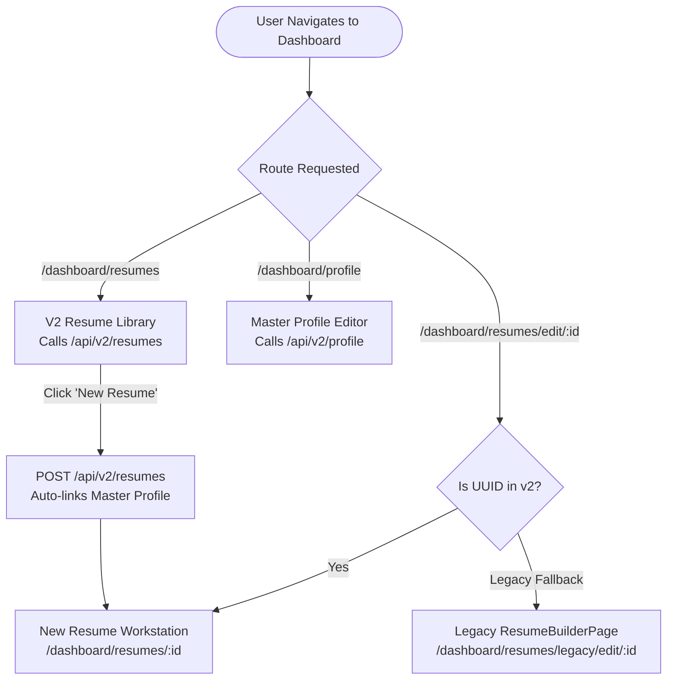
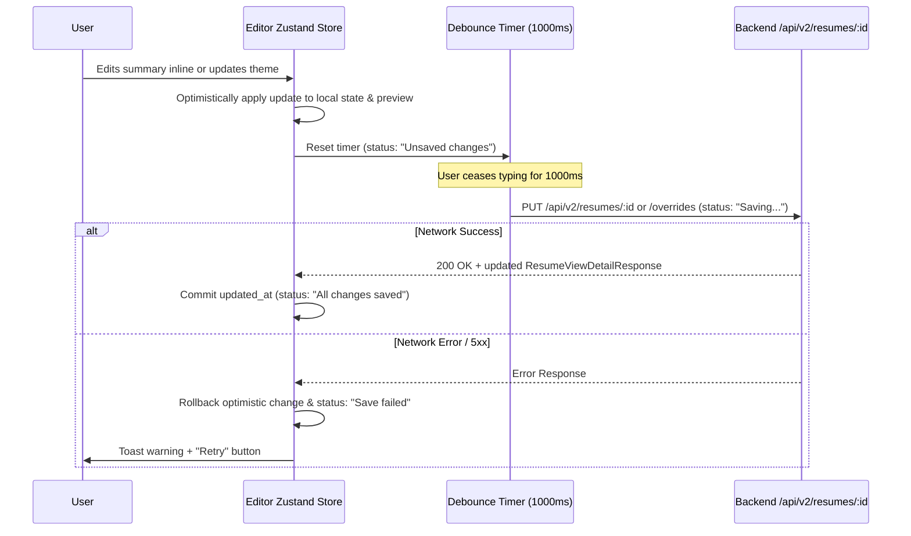

# Phase B.2 Execution Plan: Frontend Architecture & Resume Workstation

**Target:** Refactor the JobLume AI frontend to deliver the three-tier Master Profile / Resume View / Version workstation powered by the live `/api/v2/*` backend APIs.
**Author:** AI Technical Specialist & Pair Programmer
**Status:** DRAFT — Awaiting Review & Authorization
**Document Version:** 1.0
**Associated Milestone:** Phase B.2 (Frontend Only)

---

## 1. Objective and Scope

### 1.1 Objective
Phase B.1 deployed the foundational backend data hierarchy (canonical Master Profile, tailored Resume Views, immutable Version Snapshots). Phase B.2 delivers the user-facing web application that brings this data hierarchy to life. Users will, for the first time, curate their permanent career record in a dedicated Master Profile and assemble tailored, styled resume views with live multi-page preview and instant historical restore.

### 1.2 In-Scope Deliverables (Phase B.2)
1. **Master Profile Editor (`/dashboard/profile`):**
   - Comprehensive form-based career bank for all 10 canonical sections (`personal_info`, `summary`, `experience`, `education`, `projects`, `skills`, `certifications`, `languages`, `awards`, `custom_sections`).
   - Client-side UUID minting matching backend schemas.
   - Skill tag management (`SkillItemSchema = { name, tags }`) and inline bullet tagging (`BulletItemSchema = { id, text, tags }`).
2. **Resume View Workstation (`/dashboard/resumes/:id`):**
   - High-performance split workstation: left configuration panel + right live paper preview.
   - Entry selection checkboxes (filtering master entries into specific tailored views).
   - Section reordering (drag-and-drop with full keyboard accessibility) and section visibility toggles.
   - Styling controls: Template selector, font picker, and dynamic color picker with WCAG contrast guard.
3. **Template Rendering System:**
   - Standardized React template interface driven by live `resolved_data`.
   - Initial implementation of two core templates: `minimal-ats` (ATS-optimized single column) and `modern-professional` (structured modern layout).
4. **Targeted Inline Editing (Preview Pane):**
   - Direct-manipulation inline editing for high-frequency tailored fields (`summary`, `experience` bullet points, and resume title).
   - Non-destructive staging into `content_overrides` without altering the canonical Master Profile.
5. **Autosave Engine:**
   - 1000ms debounced auto-sync with optimistic state updates, background rollback on error, and status indicators (`Saving...`, `Unsaved changes`, `All changes saved`).
6. **Live Multi-Page Preview & Fit Guidance:**
   - True A4/Letter paper aspect ratio simulation with real-time DOM height measurement.
   - Dynamic page-break boundaries and visual page-fit indicator (e.g., "1.0 Page (Optimal)", "1.2 Pages (Overflow Warning)").
7. **Version History Slide-Over Drawer:**
   - Historical snapshot drawer listing versions descending (`v3, v2, v1`) with timestamps and change sources.
   - One-click restore flow featuring automatic pre-restore checkpoint safeguards.
8. **Free Tier Watermark Component:**
   - Preview-only visual overlay positioned on the paper canvas without contaminating data models.

### 1.3 Out-of-Scope (Deferred to Later Sub-Phases)
- **Backend Mutations:** Zero backend code or database migrations. All `/api/v2/*` endpoints remain frozen.
- **Serverless PDF/DOCX Export Engine (Phase B.3):** Actual file downloads continue using existing legacy export endpoints or remain disabled until B.3 replaces them with the headless Chromium PDF service.
- **Watermark Enforcement & Monetization Gating (Phase B.4):** Stripe/billing integration and hard server-side PDF gating.
- **Remaining Template Catalog (Phase B.4):** Additional templates (`creative-portfolio`, `executive-brief`, etc.) will be added in B.4 once the core engine is proven.
- **AI Tailoring UI (Phase C):** Job description matching and automated bullet rewriting modals.
- **Mobile Native Optimization:** Responsive layout with desktop-first productivity focus (>1024px viewport optimal).

---

## 2. Coexistence Strategy

### 2.1 The Coexistence Challenge
Currently, users interact with the legacy `/resume/*` endpoints through `ResumeBuilderPage.tsx` and `MyResumesPage.tsx`. In Phase B.1, both legacy tables and new v2 tables were deployed concurrently. In production, there is currently 1 admin user and 0 active resumes.

### 2.2 Decision: Option A+ (Progressive Direct Transition with Guarded Legacy Fallback)



### 2.3 Rationale
1. **Zero Data Disruption:** With 0 existing customer resumes in production, there is no legacy user migration baggage. Presenting dual resume lists in the UI would confuse users and double the QA testing surface.
2. **Single Primary Workstation:** The `/dashboard/resumes` page immediately becomes the v2 Resume View library. Clicking "New Resume" provisions a new v2 Resume View via `POST /api/v2/resumes` and opens the new editor.
3. **Guarded Backward Compatibility:** The legacy `ResumeBuilderPage.tsx` is preserved untouched at `/dashboard/resumes/legacy/edit/:id` behind an internal route flag. If any external integration or legacy link accesses `/dashboard/resumes/edit/:id`, a lightweight route inspector attempts to resolve the record: if it is a v2 view, it routes to the v2 editor; if it is a legacy record, it serves the legacy page.
4. **Retirement Timeline:** The legacy builder page and legacy API methods will be cleanly excised in a dedicated cleanup PR after Phase B.3 PDF rendering verifies 100% production equivalence.

---

## 3. Editor Architecture

### 3.1 Hybrid Editor Design
To satisfy PRD §4.3 without ballooning implementation risk, the editor employs a **Hybrid Configuration & Direct-Manipulation Architecture**:

```
┌─────────────────────────────────────────────────────────────────────────────────────────────────────────┐
│ Top Toolbar: Title Input | Autosave Status | Version History Button | Preview Scale | Manual Save Button│
├──────────────────────────────────────────────────┬──────────────────────────────────────────────────────┤
│ Left Panel: Structured Configuration (45%)       │ Right Panel: Live Paper Preview (55%)                │
│ ┌──────────────────────────────────────────────┐ │ ┌──────────────────────────────────────────────────┐ │
│ │ Tabs: [Content & Entries] [Styling] [Layout] │ │ │ [Page Fit: 1.0 Page (Optimal)]    [Zoom: 100%]   │ │
│ ├──────────────────────────────────────────────┤ │ ├──────────────────────────────────────────────────┤ │
│ │ • Section Visibility Toggles (Eye icon)      │ │ │ ┌──────────────────────────────────────────────┐ │ │
│ │ • Entry Checkboxes (Select from Master)      │ │ │ │ Header & Contact (Read-only from Master)     │ │ │
│ │ • Section Reorder (Drag Handle + Up/Down)    │ │ │ │ Summary ([Inline Editable])                  │ │ │
│ │ • Template & Font Dropdowns                  │ │ │ │ Experience Entry                             │ │ │
│ │ • Color Picker + Contrast Guard Pill         │ │ │ │   • Bullet 1 ([Inline Editable Override])    │ │ │
│ │ • Tailored Override Indicator Badges         │ │ │ │   • Bullet 2 ([Inline Editable Override])    │ │ │
│ │                                              │ │ │ │ [--- Page Break Line (Calculated) ---]       │ │ │
│ │                                              │ │ │ └──────────────────────────────────────────────┘ │ │
│ └──────────────────────────────────────────────┘ │ └──────────────────────────────────────────────────┘ │
└──────────────────────────────────────────────────┴──────────────────────────────────────────────────────┘
```

#### What is Form-Configured (Left Pane):
- **Entry Selection:** Checkboxes selecting which Master Profile items appear in this specific resume view (`selected_entry_ids`).
- **Section Order & Visibility:** Drag-and-drop handles and eye-toggle buttons controlling `section_order` and `section_visibility`.
- **Global Theme Tokens:** Template choice (`template_id`), font choice (`font_family`), primary color (`primary_color`), and target job metadata (`target_job_title`, `target_company`).
- **Master Data Curation:** Modals to "Add New Item to Master Profile" without navigating away from the editor.

#### What is Inline-Editable in B.2 (Right Preview Pane):
- **Summary Statement:** Clicking the summary block in the preview activates an in-place editing box.
- **Experience Bullets:** Clicking any bullet text converts it into an active inline editor.
- **Resume Title:** Direct editing in the top toolbar.

#### Why Limit Inline Scope in B.2?
Directly inline-editing multi-field structured entities (such as company name, role, start date, end date, location, and degree) creates severe cursor-jumping, layout shifting, and date parsing bugs. By keeping multi-field structural items form-managed and reserving inline editing for prose blocks (`summary`, `bullets`), B.2 delivers immediate user value with zero UI instability. Full inline coverage for secondary fields can expand smoothly in B.3/B.4.

### 3.2 Autosave Engine & State Synchronization



#### Detailed Autosave Rules:
1. **Debounce Threshold:** 1000ms of inactivity after any keystroke or configuration toggle.
2. **Optimistic Updates:** Local state updates immediately so the preview re-renders with zero latency (60fps).
3. **Dirty State Tracking:** A `dirtyFields: Set<string>` tracks modified paths (`title`, `styling`, `overrides`, `selection`, `ordering`).
4. **Targeted Endpoints:**
   - Styling, section order, visibility, selection changes → `PUT /api/v2/resumes/{id}`.
   - Text overrides → `PUT /api/v2/resumes/{id}/overrides`.
5. **Conflict Resolution:** Multi-tab edits compare `updated_at`. If the server returns a timestamp newer than local initial load, a non-intrusive notification banners: *"This resume was updated in another tab. [Reload to sync]"*.
6. **Offline Queue:** If `navigator.onLine === false`, the store transitions to `"Offline — saving locally"` and stores changes in `sessionStorage`. When the browser fires `online`, the pending queue automatically flushes.
7. **Explicit Save Button:** A prominent toolbar button allows users to immediately flush the debouncer and provides peace of mind.

### 3.3 Inline Editing Mechanics
1. **Component:** Implemented via `<InlineEditable />`, a focused wrapper utilizing a sanitized `contentEditable="plaintext-only"` container.
2. **Keyboard Mapping:**
   - `Enter`: Commits the current bullet text and blurs the editor.
   - `Shift + Enter`: Inserts a soft newline within the same bullet.
   - `Escape`: Reverts changes to the pre-focus value and exits edit mode.
3. **Sanitization:** All pasted text is intercepted (`onPaste`), stripped of rich tags, styling attributes, and scripts via DOMParser, leaving only clean text. Basic inline formatting (`Ctrl+B` for bold, `Ctrl+I` for italic) is preserved via clean HTML markers (`<strong>`, `<em>`).
4. **Override Staging:** When a bullet with ID `b-1` under experience `e-1` is modified, the editor verifies if the value differs from `masterProfile.experience[e-1].bullets[b-1].text`:
   - If different: Dispatches to store `content_overrides['e-1'].bullets['b-1'] = newValue`.
   - If restored to exact match: Deletes key from `content_overrides`.
   - A subtle badge (purple dot + "Tailored") appears next to the field in both preview and form panel, with a one-click "Reset to Master" icon.

---

## 4. Template System Architecture

### 4.1 Data-Driven Registry
Templates are decoupled from the editor shell. Each template is registered in a central catalog:

```typescript
export interface TemplateDefinition {
  id: string;
  name: string;
  description: string;
  category: 'ats' | 'modern' | 'creative';
  isAtsSafe: boolean;
  supportsPhoto: boolean;
  thumbnailUrl: string;
  defaultPrimaryColor: string;
  component: React.ComponentType<TemplateComponentProps>;
}

export interface TemplateComponentProps {
  data: ResolvedResumeData;
  primaryColor: string;
  fontFamily: string;
  isEditable?: boolean;
  onEditField?: (path: string, value: string) => void;
}
```

### 4.2 Initial Phase B.2 Templates
1. **`minimal-ats`:**
   - Single-column layout, standard black/gray text with primary color accents on section headers.
   - Clean horizontal divider rules, standard system serif/sans typography, no icons in contact block for 100% ATS parser compatibility.
2. **`modern-professional`:**
   - Asymmetric modern layout: Header with subtle colored background banner or left border accent.
   - Two-column skills/education grid with standard experience timeline. High visual polish for human recruiters.

### 4.3 Shared CSS Design Tokens
All templates consume standardized CSS Custom Properties injected into the preview container root:
```css
.resume-preview-container {
  --resume-primary: #2563EB;
  --resume-font: 'Inter', sans-serif;
  --resume-font-size-base: 10pt;
  --resume-font-size-name: 20pt;
  --resume-font-size-title: 12pt;
  --resume-font-size-heading: 11pt;
  --resume-line-height: 1.4;
  --resume-page-margin: 18mm;
  --resume-accent-contrast: #FFFFFF;
}
```

---

## 5. Version History Slide-Over Drawer

### 5.1 UX & Interaction Flow
1. **Access Point:** Top workstation toolbar includes a button: `History (3)` displaying total snapshot count.
2. **Drawer Presentation:** Sliding in from the right edge (`width: 380px`), overlaying the configuration form while keeping the live paper preview visible.
3. **Version Item Card:**
   - Version number pill (`v3`, `v2`, `v1`).
   - Relative timestamp ("Saved 2 hours ago") + absolute tooltip.
   - Change source badge: `manual` (blue) vs `restore_checkpoint` (amber).
   - Label and optional notes.
   - Action buttons: "Preview" and "Restore".
4. **Preview Mode:** Clicking "Preview" temporarily renders that version's immutable `snapshot_data` into the paper preview with a prominent banner: *"Previewing Version 2 (Read Only) — [Exit Preview] [Restore This Version]"*.
5. **Restore Flow:**
   - Clicking "Restore" opens a confirmation modal:
     > **Restore Version 1?**
     > Restoring will revert this view's configuration, styling, and text overrides back to Version 1.
     > *JobLume AI will automatically create an instant backup checkpoint of your current state before restoring.*
   - Confirmed action dispatches `POST /api/v2/resumes/{id}/versions/{vid}/restore`.
   - The returned restored view updates local state immediately; the new pre-restore checkpoint is added to the version list; toast confirms: *"Restored to Version 1"*.

---

## 6. Preview Engine & Page-Break Simulation

### 6.1 Paper Simulation
The preview canvas mimics physical paper dimensions:
- **Aspect Ratio:** ISO A4 (`210mm x 297mm`) and US Letter (`8.5in x 11in`), toggleable in preview toolbar.
- **Display Scale:** Zoom controls (50%, 75%, 100%, Fit-to-Width) calculated via CSS `transform: scale(...)`.
- **Styling:** Subtle shadow, crisp border, high-contrast white paper sheet against neutral canvas background (`--bg-tertiary`).

### 6.2 Page-Break Calculation Algorithm
1. **Measurement:** A lightweight `ResizeObserver` monitors section DOM elements within the `.resume-sheet` wrapper.
2. **Page Boundary:** The printable page height is computed:
   $$\text{PageHeightPx} = 1123\text{px (at 96 DPI for A4)} - (2 \times \text{MarginPx})$$
3. **Break Projection:** For every section or bullet item, its cumulative `offsetTop + offsetHeight` is evaluated:
   - If an element crosses multiples of $\text{PageHeightPx}$, a dynamic virtual page-break marker is rendered across the preview sheet.
   - Marker displays: `--- Page 2 Boundary (Cut line) ---` with a light red/amber dashed line.
4. **Fit Guidance Pill:** Displayed prominently in the preview header:
   - **`1.0 Page (Optimal)`** (Green) — Content occupies 85%–98% of Page 1.
   - **`1.2 Pages (Overflow Warning)`** (Amber) — Content spills 3–5 lines onto Page 2; recommendations suggested: *"Shorten summary by 2 lines or hide 1 project to fit on 1 page."*
   - **`2.0 Pages (Multi-page Complete)`** (Blue) — Content cleanly fills two pages.

---

## 7. Theme & Contrast Guard

### 7.1 WCAG 2.1 Contrast Calculation
The primary color is used for headings, accent borders, and skill tags against white (`#FFFFFF`) paper backgrounds.
The luminance algorithm calculates relative luminance:
$$L = 0.2126 \times R_{\text{srgb}} + 0.7152 \times G_{\text{srgb}} + 0.0722 \times B_{\text{srgb}}$$
$$\text{Contrast Ratio} = \frac{L_{\text{white}} + 0.05}{L_{\text{color}} + 0.05}$$

### 7.2 Guard Behavior
1. **Thresholds:**
   - $\ge 4.5:1$ — **Compliant (WCAG AA)**.
   - $3.0:1 \text{ to } 4.5:1$ — **Large Text Only** (acceptable for 18pt+ headings, warning for body text).
   - $< 3.0:1$ — **Non-Compliant (Fail)**.
2. **User Feedback:**
   - Displayed directly below the color picker in the Left Panel.
   - Compliant: Green checkmark `4.8:1 (WCAG AA Pass)`.
   - Non-compliant: Amber warning pill: `2.8:1 Low Contrast — hard to read on white paper. [Suggest Darker Variant]`.
   - Clicking `[Suggest Darker Variant]` automatically shifts color lightness down in HSL space to achieve exactly 4.5:1.
   - Per PRD §4.5, saving non-compliant colors is **permitted** (non-blocking warning).

---

## 8. Route Structure & Navigation

### 8.1 Route Map

```
/dashboard
  ├── (index)                 → DashboardHome.tsx
  ├── profile                 → MasterProfilePage.tsx (NEW: Career Source of Truth)
  ├── resumes                 → ResumeLibraryPage.tsx (NEW: V2 Resume View Grid)
  ├── resumes/:id             → ResumeViewEditorPage.tsx (NEW: Workstation)
  ├── resumes/legacy/edit/:id → ResumeBuilderPage.tsx (LEGACY Fallback)
  ├── templates               → TemplatesPage.tsx (Updated to preview v2 templates)
  ├── job-tailor              → JobTailorPage.tsx (Existing)
  ├── cover-letters           → CoverLetterPage.tsx (Existing)
  ├── ats-scanner             → ATSScannerPage.tsx (Existing)
  ├── applications            → ApplicationTrackerPage.tsx (Existing)
  └── settings                → SettingsPage.tsx (Account Name/Email/Password)
```

### 8.2 Navigation & Sidebar Updates
- **Sidebar Profile Link:** Navigates to `/dashboard/profile` (Master Profile Editor). The existing account settings (name, password) are unified under `/dashboard/settings`.
- **Sidebar Resumes Link:** Navigates to `/dashboard/resumes`.
- **Top Actions:** "Create Resume" everywhere routes to v2 creation flow (`POST /api/v2/resumes` -> `/dashboard/resumes/:id`).

---

## 9. Component Inventory

### 9.1 New Components to Create

| File Path | Description |
| :--- | :--- |
| `frontend/src/services/apiV2.ts` | Complete TypeScript Axios client for all 11 `/api/v2/*` endpoints |
| `frontend/src/types/v2.ts` | Strict TypeScript types mirroring backend Pydantic schemas |
| `frontend/src/stores/useResumeEditorStore.ts` | Zustand store managing editor state, selection, overrides, and debounced autosave |
| `frontend/src/stores/useMasterProfileStore.ts` | Zustand store managing Master Profile data and async syncing |
| `frontend/src/pages/dashboard/MasterProfilePage.tsx` | Master Profile Editor page (10 career bank sections) |
| `frontend/src/pages/dashboard/ResumeLibraryPage.tsx` | V2 Resume View grid listing cards, target jobs, and version counts |
| `frontend/src/pages/dashboard/ResumeViewEditorPage.tsx` | Main split-pane workstation layout |
| `frontend/src/components/editor/EditorToolbar.tsx` | Title input, autosave indicator, history toggle, zoom controls, save button |
| `frontend/src/components/editor/ConfigPanel.tsx` | Left panel container for tabs: Entries, Styling, Layout |
| `frontend/src/components/editor/SectionOrderList.tsx` | Drag-and-drop section list with keyboard accessible up/down controls |
| `frontend/src/components/editor/EntrySelector.tsx` | Checkbox selector for filtering master entries into view |
| `frontend/src/components/editor/ThemeSelector.tsx` | Template dropdown, font picker, color picker, contrast guard |
| `frontend/src/components/editor/PaperPreview.tsx` | Right panel paper canvas with zoom, page break calculation, fit pill |
| `frontend/src/components/editor/InlineEditable.tsx` | Sanitized contentEditable wrapper for summary and experience bullets |
| `frontend/src/components/editor/VersionHistoryDrawer.tsx` | Slide-over drawer with version snapshot cards and restore flow |
| `frontend/src/components/editor/WatermarkOverlay.tsx` | Preview-only non-intrusive watermark overlay for free tier |
| `frontend/src/components/templates/TemplateRegistry.ts` | Catalog registering template metadata and component mappings |
| `frontend/src/components/templates/MinimalAtsTemplate.tsx` | Clean, high-legibility ATS-optimized template component |
| `frontend/src/components/templates/ModernProfessionalTemplate.tsx`| Modern accent-bar structured template component |

### 9.2 Modified Files

| File Path | Nature of Modification |
| :--- | :--- |
| `frontend/src/App.tsx` | Add routes for Master Profile (`/dashboard/profile`), V2 Library (`/dashboard/resumes`), V2 Editor (`/dashboard/resumes/:id`), and legacy fallback |
| `frontend/src/components/layout/Sidebar.tsx` | Update navigation links and icons for Master Profile career bank |
| `frontend/src/pages/dashboard/SettingsPage.tsx` | Incorporate user name/email settings previously in old ProfilePage |

---

## 10. Complexity Ranking & Implementation Sequence

### 10.1 Complexity & Risk Ranking

```
[Rank 1 - Highest Risk] ── Inline Editing Mechanics (contentEditable, caret restoration, multi-line bullets, override diffing)
[Rank 2 - High Risk]     ── Page-Break Measurement & Fit Guidance (dynamic DOM calculation across fonts and zoom levels)
[Rank 3 - Moderate Risk] ── Autosave Debouncer & Race Condition Handling (optimistic rollbacks, tab synchronization)
[Rank 4 - Moderate Risk] ── Master Profile 10-Section Form & Bullet Tagging (large UI surface, schema compliance, UUID minting)
[Rank 5 - Low/Med Risk]  ── Version History Drawer & Restore Safeguard (state replacement, preview switching)
[Rank 6 - Low Risk]      ── Template System & Registry (data-driven rendering, CSS token isolation)
[Rank 7 - Lowest Risk]   ── Route Transitions, Sidebar Wiring & Contrast Guard Math
```

### 10.2 Construction Strategy
Build the foundational, data-heavy layers first before introducing interactive preview enhancements. This guarantees the API client and data stores are rock-solid before handling complex inline DOM events.

---

## 11. Test Plan

### 11.1 Unit & Component Tests (Vitest + React Testing Library)
1. **Contrast Guard:** Test relative luminance and WCAG AA ratio calculation against edge-case hex colors (`#FFFFFF`, `#000000`, `#2563EB`, `#FBBF24`).
2. **Inline Sanitizer:** Assert pasted HTML containing `<script>`, `style="..."`, or arbitrary `<div>` tags is stripped to plain text or valid `<strong>`/`<em>`.
3. **Override Diffing:** Assert editing an experience bullet dispatches precisely `content_overrides[exp_id].bullets[bullet_id] = text`, leaving untouched bullets clean.
4. **Keyboard Reordering:** Assert triggering "Move Up" button shifts section order index and updates `aria-live` announcement.

### 11.2 End-to-End User Journey Tests (Playwright)
- **Journey 1: Master Career Bank Curation**
  User navigates to `/dashboard/profile` → adds experience entry with 2 tagged bullets → adds skills with tags → reloads page → verifies persistence from backend.
- **Journey 2: View Tailoring & Styling**
  User creates new resume view → deselects 1 entry → reorders skills above experience → switches primary color → verifies live preview updates.
- **Journey 3: Inline Overrides & Version Snapshot**
  User clicks summary in preview → edits text inline → asserts autosave indicator reflects "All changes saved" → clicks "Save Version" with label "Tailored v1" → asserts v1 appears in history drawer.
- **Journey 4: Version Restoration Safeguard**
  User changes template and deletes text → opens drawer → clicks "Restore v1" → confirms dialog → asserts checkpoint v2 is auto-created and view reverts to v1 config.

---

## 12. Sub-Phasing & Milestone Deliverables

To maintain velocity, eliminate mammoth PRs, and ensure thorough review at each milestone, Phase B.2 is divided into **three structured sub-PRs**:

### Sub-PR B2.1: Master Profile & API Client Foundation
- **Deliverables:**
  - `frontend/src/services/apiV2.ts` and `frontend/src/types/v2.ts`.
  - Master Profile Store (`useMasterProfileStore.ts`).
  - Dedicated Master Profile Editor page (`/dashboard/profile`) supporting all 10 sections.
  - Bullet tagging UI and skill tag pill editor.
  - Unit tests for data normalization and UUID minting.
- **Verification:** User can populate their complete career bank; data persists cleanly to `GET/PUT /api/v2/profile`.

### Sub-PR B2.2: Resume View Workstation, Templates & Live Preview
- **Deliverables:**
  - V2 Resume View Library grid (`/dashboard/resumes`).
  - Resume Editor Shell (`/dashboard/resumes/:id`) with split layout.
  - Left panel controls: Entry selection checkboxes, section order drag-and-drop + keyboard controls, section visibility toggles.
  - Template Registry with initial 2 templates (`minimal-ats`, `modern-professional`).
  - Live paper preview canvas with page-break lines and fit guidance pill.
  - Color picker with WCAG contrast guard calculation.
- **Verification:** User can create a view from their master profile, select entries, reorder sections, adjust styling, and observe the live multi-page preview.

### Sub-PR B2.3: Inline Editing, Autosave & Version History Drawer
- **Deliverables:**
  - `<InlineEditable />` preview mechanics for summary and experience bullets.
  - Staging inline changes into `content_overrides` without touching master data.
  - 1000ms debounced autosave engine with status indicators and offline queue.
  - Version History slide-over drawer with version preview mode.
  - Instant version restore flow with automatic checkpoint generation.
  - Playwright E2E test suite covering complete user journeys.
- **Verification:** Full end-to-end authoring experience: inline editing, automatic saving, snapshot generation, and reliable rollback.

---

## 13. Open Questions for Review

Before beginning code implementation in Sub-PR B2.1, please confirm or provide feedback on these design decisions:

1. **Routing & Old Profile Migration:**
   Currently, `/dashboard/profile` holds account fields (full name, email). Does moving user account settings into `/dashboard/settings` and repurposing `/dashboard/profile` as the **Master Profile (Career Bank)** align with your vision, or would you prefer a separate top-level route such as `/dashboard/career-bank` or `/dashboard/master-profile`?
2. **Inline Formatting Toolbar:**
   For inline editing in B.2, should we include a floating formatting bubble (Bold/Italic/Link tooltip on text selection), or is standard keyboard shortcut handling (`Ctrl+B`, `Ctrl+I`, `Ctrl+K`) sufficient for the B.2 proof-of-concept?
3. **Free Tier Watermark Positioning:**
   In the preview pane, should the Free tier watermark appear as a discreet bottom-right diagonal badge (e.g., *"Created with JobLume AI"*), or as a centered semi-transparent background watermark across each page?
4. **Sub-PR Cadence:**
   Do you approve the 3-sub-PR breakdown (B2.1 Master Profile → B2.2 Workstation/Templates → B2.3 Inline/Autosave/Versions), with a review and test pass after each sub-PR?
